# Software Requirements Specification (SRS)
## ระบบหาหอพัก

## 1. บทนำ (Introduction)

### 1.1 วัตถุประสงค์ (Purpose)
เอกสารนี้ระบุความต้องการของระบบหาหอพัก เพื่อใช้เป็นข้อตกลงร่วมกันระหว่างสมาชิกทีมพัฒนา
ผู้ทดสอบ และอาจารย์ผู้ประเมิน และเป็นต้นทางของ spec, plan, tasks, test และ Prototype

### 1.2 ขอบเขตของระบบ (Scope)
<!-- TODO: ใส่ข้อมูลขอบเขตของระบบ -->
**ระบบทำอะไร (In Scope)**
- ค้นหาและดูข้อมูลหอพัก (UC-01) รับผิดชอบโดย 660710709 ธนกฤต เวทยนุกูล
- จัดการข้อมูลหอพัก (UC-03) รับผิดชอบโดย 670710713 ชนัสถ์นันท์ วะรีวะราช
- ดูสถิติหอพัก (UC-05) รับผิดชอบโดย 670710729 พิทักษ์พล ชยานนท์นุรักษ์
- จัดการบัญชีผู้ใช้ (UC-08) รับผิดชอบโดย 670710746 ณัฎฐพล ดาเจริญ

**ระบบไม่ทำอะไร (Out of Scope)**
- สมัครสมาชิก (UC-02) รับผิดชอบโดย 660710709 ธนกฤต เวทยนุกูล
- อัพเดทสถานะห้องว่าง (UC-04) รับผิดชอบโดย 670710713 ชนัสถ์นันท์ วะรีวะราช
- นัดหมายดูห้องพัก (UC-07) รับผิดชอบโดย 670710746 พิทักษ์พล ชยานนท์นุรักษ์
- เข้าสู่ระบบ (UC-07) รับผิดชอบโดย 670710746 ณัฎฐพล ดาเจริญ
- เขียนและแก้ไขรีวิวหอพัก (UC-09) รับผิดชอบโดย 670710713 ชนัสถ์นันท์ วะรีวะราช
  
### 1.3 คำนิยาม ตัวย่อ และคำศัพท์ (Definitions, Acronyms, Abbreviations)

| คำ | ความหมาย |
|---|---|
| Guest | ผู้เยี่ยมชมที่ยังไม่ได้เข้าสู่ระบบ |
| Resident | ผู้ใช้ที่สมัครสมาชิกแล้วและใช้บริการหอพัก |
| Dormitory Owner | เจ้าของหอพักที่ลงข้อมูลในระบบ |
| Admin | ผู้ดูแลระบบที่ตรวจสอบและอนุมัติหอพัก |
| UC | Use Case |
| FR / NFR | Functional / Non-Functional Requirement |
| AC | Acceptance Criteria |
| SRS | Software Requirements Specification |

### 1.4 เอกสารอ้างอิง (References)
- ISO/IEC/IEEE 29148:2018 Requirements engineering
- เอกสารประกอบวิชา Requirement 2569
- [Spec รายฟีเจอร์](../../specs/)
- [Prototype](../Prototype/README.md)

### 1.5 ภาพรวมของเอกสาร (Document Overview)
- หัวข้อ 2-3: ที่มาของความต้องการและผู้มีส่วนได้ส่วนเสีย
- หัวข้อ 4: ภาพรวมระบบ
- หัวข้อ 5: User Stories และ Use Cases
- หัวข้อ 6-8: FR, NFR, Acceptance Criteria
- หัวข้อ 9-10: ข้อมูล/อินเทอร์เฟซ และคำถามที่ยังไม่รู้
- หัวข้อ 11-12: Traceability Matrix และภาคผนวก

## 2. ที่มาของความต้องการ (Requirements Elicitation)

### 2.1 วิธีการเก็บข้อมูล <!-- TODO: ใส่ข้อมูลหลักฐานของตัวเองโดยการใส่ลิงค์ drive และเปิด public -->
| รหัส | บทบาท (Stakeholder) | วันที่ | ระยะเวลา | ผู้สัมภาษณ์ / ผู้เก็บข้อมูล | หลักฐาน |
|---|---|---|---|---|---|
| INT-01 | แม้บ้านที่หอพักกัลยาเฮ้าส์ | 13-09-2026 | 5.39 นาที | 660710709 ธนกฤต เวทยนุกูล | [วิดีโอ INT-01](https://drive.google.com/file/d/1Ziy72skQVAHqkxPHpnidwv1O3o0OlDFN/view) |
| INT-02 | พ่อบ้านผู้ดูแลหอพักปัทมาเพลส | 13-09-2026 | ไม่ได้บันทึก | 670710729 พิทักษ์พล ชยานนท์นุรักษ์ | [บันทึกการสัมภาษณ์ INT-02](https://drive.google.com/file/d/17hV2dL3QTvSc8A2byCuE0LztIJkpn81M/view?usp=sharing) |
| INT-03 | เจ้าของหอพักแก้วขวัญเพลส | 13-09-2026 | ไม่ได้บันทึก | 670710322 ธันยธรณ์ บุญมาก ,670710713 นายชนัสถ์นันท์ วะรีวะราช | [บันทึกการสัมภาษณ์ INT-03](https://drive.google.com/file/d/1k0KgiIQpnk7n59rY1ltkkADBaKqolBmI/view?usp=sharing) |

### 2.2 บทสัมภาษณ์/ข้อมูล ที่สำคัญ <!-- TODO: ใส่ข้อมูลหลักฐานของตัวเอง -->
| คำพูด (ถอดความ) | ประเด็นที่ได้ | ประเภท (ปัญหา / ความต้องการ) | นำไปสู่ |
|---|---|---|---|
| "ติดต่อผมก็ติดต่อทางหน้าเพจ แล้วบางคนก็มีเบอร์ติดต่อจากเพื่อน เพื่อนบอกต่อกัน จากคนแนะนำมา" | ลูกค้าส่วนใหญ่ติดต่อผ่านเพจและเบอร์ที่ได้จากการบอกต่อ ไม่มีช่องทางกลางให้ค้นหา | ปัญหา | P-01, P-07 |
| "เรากพาไปดูห้อง แล้วก็บอกราคาว่าลูกค้าโอเคไหม" | ราคาแจ้งเมื่อพาดูห้องเท่านั้น ไม่ได้แจ้งล่วงหน้า | ปัญหา | P-04 |
| "ถามว่ามีความปลอดภัยไหม แล้วก็ค่าน้ำค่าไฟเท่าไหร่ ประมาณนี้" | คำถามซ้ำที่ผู้สนใจถามตอนมาดูหอพัก | ปัญหา | P-03 |
| "บอกตั้งแต่ลูกค้ามาดูห้องว่าโอเคไหม แล้วบอกราคา บอกกฎระเบียบทุกอย่างในวันนั้น ถ้าลูกค้าโอเคก็ค่อยจัดการต่อ" | กฎระเบียบและค่าใช้จ่ายแจ้งตอนมาดูห้องเท่านั้น | ปัญหา | P-04 |
| "รวมหอพักมาอยู่ในเว็บไซต์ แล้วให้นักศึกษาเลือกได้ เหมือนมีเรทราคา แล้วก็ระบุเป็นหอพักชายหญิง" | อยากได้เว็บรวมหอพักที่กรองตามราคาและประเภทชาย/หญิงได้ | ความต้องการ | P-06, P-07 |
| ประชาสัมพันธ์หอพักผ่านการบอกต่อและกลุ่ม Facebook | ช่องทางประชาสัมพันธ์หอพัก | ความต้องการ | P-07 |
| ข้อมูลที่ต้องอัปเดตบ่อยที่สุดคือสถานะห้องว่าง | สถานะห้องพักมีการเปลี่ยนแปลงบ่อย | ปัญหา | P-02 |
| ไม่มีปัญหาในการอัปโหลดรูปภาพ รายละเอียดห้องพัก และสิ่งอำนวยความสะดวก | สามารถจัดเตรียมข้อมูลห้องพักได้ | ความต้องการ | - |
| ปัจจุบันบันทึกสถานะห้องพักไว้ในสมุด | การจัดเก็บสถานะห้องพักยังใช้การจดบันทึก | ปัญหา | P-02 |
| ผู้สนใจต้องโทรศัพท์มานัดหมายเพื่อเข้าดูห้องและชำระเงินมัดจำ | ขั้นตอนการนัดหมายเข้าดูห้องพัก | ข้อมูลกระบวนการปัจจุบัน | - |
| คำถามที่ผู้สนใจถามบ่อยคือค่าเช่าห้องและเงินมัดจำ | มีการสอบถามข้อมูลเดิมซ้ำ | ปัญหา | P-03 |
| แจ้งกฎระเบียบ เงื่อนไข และค่าใช้จ่ายในวันแรก พร้อมมอบเอกสารกฎระเบียบให้ | การแจ้งข้อมูลกฎระเบียบและค่าใช้จ่าย | ปัญหา | P-04 |
| เมื่อห้องเต็มหรือมีห้องว่าง บุคคลภายนอกต้องเข้ามาสอบถามที่หอพัก | บุคคลภายนอกไม่สามารถตรวจสอบสถานะห้องได้ด้วยตนเอง | ปัญหา | P-02 |
| ไม่เคยพบปัญหาความเข้าใจผิดเกี่ยวกับสภาพห้อง สิ่งอำนวยความสะดวก หรือทำเลที่ตั้ง | ไม่มีปัญหาความเข้าใจผิดเกี่ยวกับข้อมูลห้องพัก | - | - |
| ปัจจุบันใช้ RentHub ในการประชาสัมพันธ์หอพัก | มีการใช้แพลตฟอร์มออนไลน์ในการประชาสัมพันธ์ | ข้อมูลปัจจุบัน | - |
| ไม่ถนัดและไม่ค่อยทราบวิธีใช้งานระบบผ่านโทรศัพท์มือถือ | การใช้งานระบบผ่านโทรศัพท์มือถืออาจเป็นอุปสรรค | ปัญหา | P-08 |
| ต้องการให้ระบบช่วยเพิ่มการมองเห็นและการเข้าถึงหอพัก เพราะปัจจุบันเน้นการพูดคุยและเจรจาโดยตรง | ต้องการเพิ่มช่องทางประชาสัมพันธ์หอพัก | ความต้องการ | P-07 |
| ต้องการให้ระบบแสดงสถานที่ใกล้เคียง เช่น สถานีรถไฟและสถานีรถตู้ | ต้องการข้อมูลสถานที่และสิ่งอำนวยความสะดวกใกล้หอพัก | ความต้องการ | P-09 |
| "ปัจจุบันลงประกาศโปรโมตหอพักผ่านเว็บไซต์ที่เกี่ยวกับหอพัก" | ใช้เว็บไซต์ภายนอกเป็นช่องทางหลักในการประชาสัมพันธ์หอพัก | ข้อมูลปัจจุบัน | - |
| "ข้อมูลที่ต้องอัปเดตบ่อยที่สุดคือห้องว่างกับข้อมูลเกี่ยวกับห้องพัก" | สถานะห้องว่างและรายละเอียดห้องพักต้องได้รับการอัปเดตอยู่เสมอ | ปัญหา | P-02 |
| "ไม่ได้มีปัญหาอะไรในการลงรูปถ่าย รายละเอียดห้อง หรือสิ่งอำนวยความสะดวก" | สามารถจัดเตรียมและลงข้อมูลหอพักได้โดยไม่มีปัญหา | ข้อมูลปัจจุบัน | - |
| "เช็กและจัดการสถานะห้องในสมุดและในคอมพิวเตอร์" | การจัดเก็บและตรวจสอบสถานะห้องพักยังใช้หลายช่องทาง | ปัญหา | P-02 |
| "ผู้สนใจเข้ามาสอบถามหรือโทรคุยก่อน แล้วจึงนัดหมายเข้ามาดูห้อง บางครั้งอาจมีปัญหานัดซ้อนหรือนัดแล้วไม่มา" | การนัดหมายยังอาศัยการติดต่อโดยตรง และอาจเกิดปัญหานัดซ้อนหรือนัดแล้วไม่มา | ปัญหา | P-05 |
| "คำถามที่ถามบ่อยคือข้อมูลเกี่ยวกับห้องพัก ราคา ห้องว่าง และรายละเอียดต่าง ๆ ของหอ" | ผู้สนใจสอบถามข้อมูลพื้นฐานซ้ำ ๆ ก่อนตัดสินใจเข้าพัก | ปัญหา | P-03 |
| "มีใบสัญญาแจ้งรายละเอียดต่าง ๆ ทั้งค่าใช้จ่ายและเงื่อนไขของหอให้ผู้เช่าเข้าใจก่อนตัดสินใจ" | มีเอกสารแจ้งเงื่อนไขและค่าใช้จ่ายให้ผู้เช่าทราบก่อนเข้าพัก | ข้อมูลปัจจุบัน | - |
| "ถ้ามีห้องว่างก็จะอัปเดตข้อมูลให้ทางเว็บไซต์ที่ลงโฆษณาไว้ทราบ" | ต้องอัปเดตสถานะห้องว่างผ่านเว็บไซต์ประชาสัมพันธ์ที่ใช้งานอยู่ | ปัญหา | P-02 |
| "บางครั้งอาจมีความเข้าใจไม่ตรงกันจากข้อมูลที่ผู้สนใจเห็นในเว็บไซต์ เพราะข้อมูลบางอย่างอาจไม่ได้อธิบายรายละเอียดทั้งหมด" | ข้อมูลบนเว็บไซต์อาจไม่ครบถ้วน ทำให้ผู้สนใจต้องสอบถามเพิ่มเติม | ปัญหา | P-04 |
| "ตอนนี้หลัก ๆ ใช้เว็บไซต์ที่ช่วยลงโฆษณาหอพักให้ ยังไม่ได้มีระบบของตัวเองโดยเฉพาะ" | ยังไม่มีระบบกลางสำหรับจัดการและประชาสัมพันธ์ข้อมูลหอพักของตนเอง | ปัญหา | P-01, P-07 |
| "อยากให้ใช้งานง่ายและไม่ซับซ้อน เพราะควรอัปเดตข้อมูลห้องพักได้สะดวกและรวดเร็ว" | ต้องการระบบที่ใช้งานง่ายและรองรับการอัปเดตข้อมูลได้สะดวก | ความต้องการ | P-08 |
| "อยากให้ช่วยเรื่องการลงและอัปเดตข้อมูลหอพัก โดยเฉพาะข้อมูลห้องว่างและรายละเอียดห้องพัก จะได้ไม่ต้องจัดการหลายช่องทาง" | ต้องการระบบศูนย์กลางสำหรับจัดการและอัปเดตข้อมูลหอพัก | ความต้องการ | P-01, P-02, P-07 |
| "อยากให้มีข้อมูลหอพักที่ชัดเจน รูปภาพตรงกับห้องจริง และมีรายละเอียดครบถ้วน" | ต้องการแสดงข้อมูลและรูปภาพหอพักที่ถูกต้องและครบถ้วน เพื่อสร้างความน่าเชื่อถือ | ความต้องการ | P-04 |

### 2.3 สรุปปัญหาที่พบ <!-- TODO: ใส่ข้อมูลหลักฐานของตัวเอง ถ้ามีเหมือนกันให้ใส่เลขตรงความถื่เพิ่มแทน -->
| รหัส | ปัญหา | ผลกระทบ | พบจาก (หลักฐาน) | ความถี่ | Stakeholder ที่ได้รับผลกระทบ | UC / FR ที่แก้ปัญหา |
|---|---|---|---|---|---|---|
| P-01 | โปรโมตหอพักผ่านช่องทางออฟไลน์เท่านั้น (หน้าตึก บอกปากต่อปาก โทรศัพท์) และไม่ได้โพสรูปหรือรายละเอียดห้องออนไลน์ | ผู้สนใจที่ไม่ได้ผ่านหน้าหอหรือไม่มีคนแนะนำเข้าไม่ถึงข้อมูลหอพัก | INT-01 ข้อ 1.1, 1.3 | 1 / 6 คน | Dormitory Owner, Guest | UC-01, FR-DOR-01, FR-DOR-03 |
| P-02 | สถานะห้องว่าง/เต็มจดในสมุดและในคอมพิวเตอร์ ไม่มีช่องทางแจ้งคนภายนอก ต้องมาถามที่หน้าหอเอง | ผู้สนใจไม่รู้ว่ามีห้องว่างหรือไม่จนกว่าจะติดต่อ และเจ้าของต้องตอบเรื่องห้องว่างเอง | INT-01 ข้อ 2.1, 3.3;INT-02 ข้อ 2, 4, 8 | 2 / 6 คน | Dormitory Owner, Guest | UC-01, FR-DOR-02 |
| P-03 | ต้องตอบคำถามซ้ำๆ เรื่องความปลอดภัย ค่าน้ำค่าไฟ ห้องว่าง และราคา | เสียเวลาตอบคำถามเดิมๆ ซ้ำกับผู้สนใจหลายราย | INT-01 ข้อ 3.1; INT-02 ข้อ 6 | 2 / 6 คน | Dormitory Owner, Guest | UC-01, FR-DOR-02, FR-DOR-03 |
| P-04 | เงื่อนไข กฎระเบียบ และค่าใช้จ่ายแจ้งเมื่อลูกค้ามาดูห้องเท่านั้น | ผู้สนใจไม่เห็นค่าใช้จ่ายและกฎก่อนเดินทางมาดูห้อง | INT-01 ข้อ 3.2; INT-02 ข้อ 7 | 2 / 6 คน | Guest, Dormitory Owner | UC-01, FR-DOR-03, DOM-RULE-01 |
| P-05 | ข้อมูลที่เปลี่ยนบ่อย (โปรโมชั่น การบริการ ค่าเช่า) ต้องคอยแจ้งหรืออัปเดตเอง และไม่มีศูนย์กลางลงข้อมูล | ข้อมูลที่ผู้สนใจได้รับอาจไม่ตรงกับปัจจุบัน | INT-01 ข้อ 1.2, 5.1 | 1 / 6 คน | Dormitory Owner, Guest | UC-03, UC-04 (นอกขอบเขต UC-01) |
| P-06 | ผู้สนใจต้องการดูตามเรทราคาและประเภทหอพักชาย/หญิง แต่ไม่มีระบบกรองให้ | หาหอพักที่ตรงเงื่อนไขได้ช้า | INT-01 ข้อ 5.1 | 1 / 6 คน | Guest, Dormitory Owner | UC-01, FR-DOR-01 |
| P-07 | ต้องการเพิ่มช่องทางประชาสัมพันธ์และการมองเห็นหอพัก | ผู้สนใจอาจเข้าถึงข้อมูลหอพักได้ไม่ทั่วถึง | INT-02 ข้อ 1, 10, 12 | 1 / 6 คน | Dormitory Owner, Guest | UC-01, FR-DOR-01, FR-DOR-03 |
| P-08 | ผู้ดูแลไม่ถนัดและไม่ค่อยทราบวิธีใช้งานระบบผ่านโทรศัพท์มือถือ | อาจเป็นอุปสรรคต่อการเรียนรู้และใช้งานระบบ | INT-02 ข้อ 11 | 1 / 6 คน | Dormitory Owner | พิจารณา NFR ด้าน Usability |
| P-09 | ต้องการให้ระบบแสดงสถานที่ใกล้เคียง เช่น สถานีรถไฟและสถานีรถตู้ | ผู้สนใจอาจต้องค้นหาข้อมูลสถานที่ใกล้เคียงจากแหล่งอื่น | INT-02 ข้อ 13 | 1 / 6 คน | Guest | ตรวจสอบ FR ด้านข้อมูลสถานที่ |

### 2.4 Journey Map

**ผู้รับผิดชอบ** 
660710709 ธนกฤต เวทยนุกูล รับผิดชอบ Phase และ Action 
660710741 ศิริวุฒิ ชัยเกียรติธรรม รับผิดชอบ Emotion 
670710713 ชนัสถ์นันท์ วะรีวะราช รับผิดชอบ Backstage และ Problem 
670710322 ธันยธรณ์ บุญมาก รับผิดชอบ Touch Point 
670710746 ณัฎฐพล ดาเจริญ รับผิดชอบ Data 
670710729 พิทักษ์พล ชยานนท์นุรักษ์ รับผิดชอบ Duration และ Opportunity 

## 3. ผู้มีส่วนได้ส่วนเสีย (Stakeholder)

### 3.1 Stakeholder Map

**ผู้รับผิดชอบ** 
660710709 ธนกฤต เวทยนุกูล 
660710741 ศิริวุฒิ ชัยเกียรติธรรม 

### 3.2 Onion Diagram

**ผู้รับผิดชอบ** 
670710729 พิทักษ์พล ชยานนท์นุรักษ์ 
670710746 ณัฎฐพล ดาเจริญ 

### 3.3 ตารางสรุป Stakeholder (บทบาท ความสนใจ อิทธิพล)
| Stakeholder | ประเภท (Primary / Secondary) | บทบาทในระบบ | ความสนใจ / สิ่งที่ต้องการ | อิทธิพล (สูง/กลาง/ต่ำ) | ผลกระทบจากระบบ (สูง/กลาง/ต่ำ) | UC ที่เกี่ยวข้อง | แหล่งข้อมูล |
|---|---|---|---|---|---|---|---|
| Guest (ผู้สนใจเช่าห้อง) | Primary | ผู้ใช้หลักที่ค้นหาและเปรียบเทียบหอพัก | ค้นหาหอพักที่ตรงความต้องการ ตรวจสอบรายละเอียดได้ถูกต้องครบถ้วน และสร้างบัญชีเพื่อใช้ฟังก์ชันอื่นของระบบ | ต่ำ | สูง | UC-01, UC-02 | UC-01, UC-02 (Stakeholder & Interest) |
| Resident (ผู้เช่า/นักศึกษา) | Primary | ผู้ใช้บริการหอพักที่พักอยู่ | นัดดูห้อง จอง ดูค่าใช้จ่าย แจ้งซ่อม และรีวิว | ต่ำ | สูง | UC-06, 08, 09, 10, 11, 12, 14 | Use Case Diagram (อนุมานจากชื่อ UC) |
| Dormitory Owner (เจ้าของหอพัก) | Primary | ผู้ให้ข้อมูลหอพักและจัดการห้องในระบบ | ให้ข้อมูลหอพักของตนแสดงต่อผู้สนใจได้อย่างถูกต้อง และจัดการห้อง ราคา สถานะห้องว่าง | สูง | สูง | UC-01, 03, 04, 05 | UC-01 (Stakeholder & Interest), System Context |
| System Admin (ผู้ดูแลระบบ) | Secondary | ดูแลและตรวจสอบข้อมูลในระบบ (ไม่มีใน System Context) | ให้การแสดงผลข้อมูลหอพักเป็นไปตามมาตรฐาน และระบบทำงานได้อย่างราบรื่น | สูง | กลาง | UC-01, UC-13 | UC-01 (Stakeholder & Interest) |

## 4. ภาพรวมของระบบ (Overall Description)

### 4.1 System Context (มุมมองของผลิตภัณฑ์ / Product Perspective)
 

**ผู้รับผิดชอบ** 
670710746 ณัฎฐพล ดาเจริญ 

### 4.2 Architecture Overview
 

**ผู้รับผิดชอบ** 
670710729 พิทักษ์พล ชยานนท์นุรักษ์ 

### 4.3 หน้าที่หลักของระบบ (Product Functions)
ระบบค้นหาและเปรียบเทียบหอพักเป็นเว็บแอปที่ช่วยให้ผู้สนใจเช่าห้องค้นหาและดูข้อมูลหอพัก
และให้เจ้าของหอพักจัดการข้อมูลของตนเอง โดยมีหน้าที่หลักดังนี้
| กลุ่มหน้าที่ | รายละเอียด | UC | ส่วนของระบบ (Architecture) |
|---|---|---|---|
| ค้นหาและดูข้อมูลหอพัก | ค้นหาหอพัก ดูห้องว่าง ราคาค่าเช่าและค่าใช้จ่าย รูปภาพ รายละเอียดห้อง และสิ่งอำนวยความสะดวก | UC-01 | User Frontend, Dormitory/Room/Availability/Price/Image & Detail API |
| ติดต่อและนัดหมาย | ติดต่อเจ้าของหอพักและนัดดูห้อง | UC-06 | Contact API |
| จัดการข้อมูลหอพัก | เพิ่ม/แก้ไขข้อมูลหอพัก ลงราคา ค่ามัดจำ ค่าใช้จ่าย เพิ่มรูปภาพและช่องทางติดต่อ | UC-03 | Admin Frontend, Dormitory/Price/Image & Detail/Contact API |
| อัปเดตสถานะห้อง | เปลี่ยนสถานะห้องว่าง/ห้องเต็ม | UC-04 | Availability API |
| ดูสถิติหอพัก | สรุปข้อมูลการใช้งานหอพักสำหรับเจ้าของ | UC-05 | ยังไม่มีใน Architecture |
| บัญชีและการเข้าสู่ระบบ | สมัครสมาชิก เข้าสู่ระบบ จัดการบัญชี | UC-02, 07, 08 | ยังไม่มีใน Architecture |
| บริการสำหรับผู้อยู่อาศัย | จองห้อง ชำระเงิน ดูค่าใช้จ่าย แจ้งซ่อม เขียนรีวิว | UC-09, 10, 11, 12, 14 | UC-11 ใช้ Price API ได้ ที่เหลือยังไม่มี |
| ควบคุมคุณภาพข้อมูล | ผู้ดูแลระบบตรวจสอบและอนุมัติหอพัก | UC-13 | ยังไม่มีใน Architecture |

### 4.4 ลักษณะของผู้ใช้ (User Characteristics)
| กลุ่มผู้ใช้ | คำอธิบาย | ทักษะด้านเทคโนโลยี |
|---|---|---|
| Guest | คนที่กำลังหาหอพัก ยังไม่ได้เป็นสมาชิก เช่น นักศึกษาใหม่ | พื้นฐาน |
| Resident | ผู้ที่พักอยู่และใช้บริการของหอพัก | พื้นฐาน |
| Dormitory Owner | เจ้าของ/ผู้ดูแลหอพักที่ลงข้อมูลในระบบ | พื้นฐานถึงปานกลาง |
| Admin | ผู้ดูแลระบบที่อนุมัติหอพัก | ปานกลาง |

### 4.5 ข้อจำกัด (Constraints)
| รหัส | ประเภท | ข้อจำกัด |
|---|---|---|
| CON-01 | เวลา / ขอบเขต | เป็นงานในรายวิชา มีเวลาจำกัด จึงพัฒนา Prototype เฉพาะ UC-01, 03, 05, 08, 10, 13 ส่วน UC อื่นทำถึงระดับ spec และ plan |
| CON-02 | เทคโนโลยี | Frontend ใช้ React (JSX), Backend แบบ API Layer (Python), ฐานข้อมูล MySQL |
| CON-03 | ระบบภายนอก | ใช้ Google Maps แสดงตำแหน่งและแผนที่ ต้องมีอินเทอร์เน็ตและเป็นไปตามเงื่อนไขการใช้งานของ Google |
| CON-04 | การพัฒนา | พัฒนาแบบ Spec-Driven Development: เขียน spec ก่อน ให้ AI สร้างทีละ task และตรวจตาม Acceptance Criteria |
| CON-05 | การชำระเงิน | ไม่เชื่อมระบบชำระเงินจริง UC-14 เป็นการจำลอง |
| CON-06 | ข้อมูลส่วนบุคคล | ข้อมูลผู้ใช้ต้องใช้อย่างเหมาะสมตามหลัก PDPA (Prototype ใช้ข้อมูลตัวอย่าง) |
| CON-07 | ทีม | ทีมพัฒนา 6 คน แบ่งความรับผิดชอบตาม UC |

### 4.6 ข้อสมมติและความเกี่ยวเนื่อง (Assumptions and Dependencies)
| รหัส | ข้อสมมติ | ผลกระทบถ้าไม่เป็นจริง |
|---|---|---|
| AS-01 | Prototype ใช้ระบบเข้าสู่ระบบจำลอง (mock login) เพราะ UC-07 ไม่ได้พัฒนาจริง | UC ที่ include UC-07 ต้องปรับการทดสอบ |
| AS-02 | มีข้อมูลผู้ใช้ หอพัก และห้องตัวอย่าง (seed data) ใน MySQL เพราะ UC-02 ไม่ได้พัฒนาจริง | ทดสอบ UC-01, 03, 05 ไม่ได้ถ้าไม่มีข้อมูล |
| AS-03 | เจ้าของหอพักกรอกข้อมูลห้อง ราคา และสถานะห้องว่างตรงตามความจริง | ข้อมูลที่ผู้ใช้เห็นอาจคลาดเคลื่อน |
| AS-04 | ผู้ใช้เข้าถึงระบบผ่านเบราว์เซอร์ที่ต่ออินเทอร์เน็ตได้ | ใช้งานไม่ได้ |
| AS-05 | หอพักแสดงในผลค้นหาหลังได้รับอนุมัติจากผู้ดูแลระบบ | ต้องปรับเงื่อนไขแสดงผล UC-01 |

## 5. Use Cases

### 5.2 Use Case Diagram
 

**ผู้รับผิดชอบ** 
660710741 ศิริวุฒิ ชัยเกียรติธรรม 

### 5.3 Use Case Specification

UC-01 | ค้นหาและดูข้อมูลหอพัก

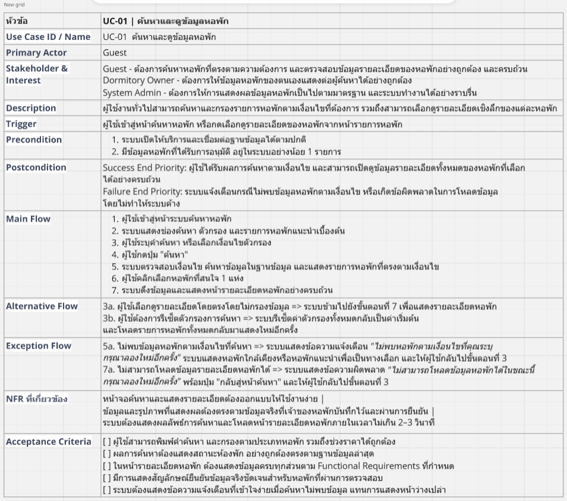

**ผู้รับผิดชอบ:** 660710709 ธนกฤต เวทยนุกูล

UC-02 | สมัครสมาชิก

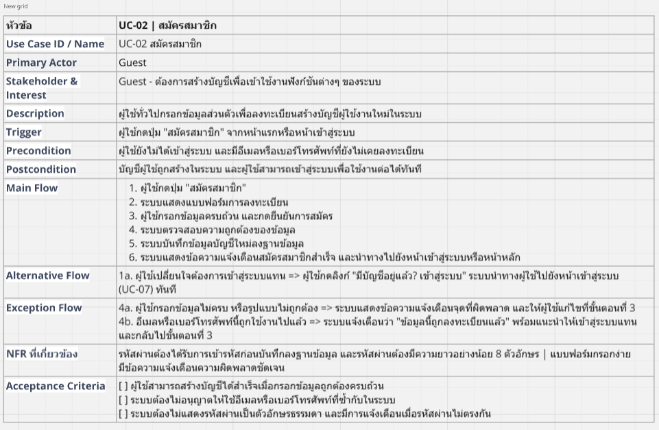

**ผู้รับผิดชอบ:** 660710709 ธนกฤต เวทยนุกูล

UC-03 | จัดการข้อมูลหอพัก

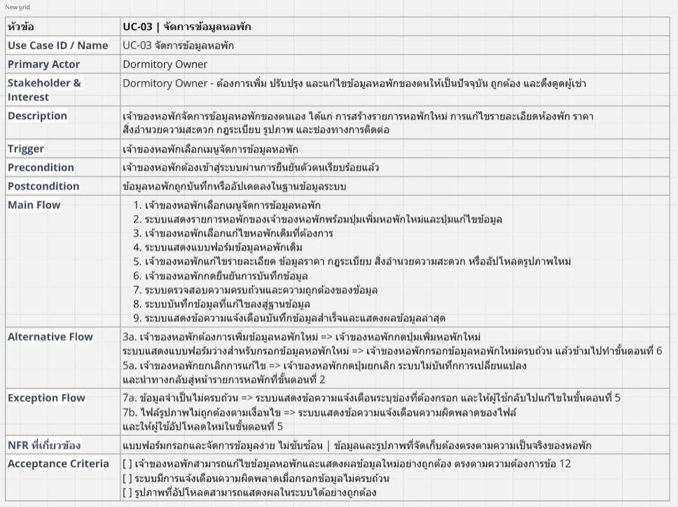

**ผู้รับผิดชอบ:** 660710709 ธนกฤต เวทยนุกูล

UC-04 | อัพเดทสถานะห้องว่าง

**ผู้รับผิดชอบ:** 660710709 ธนกฤต เวทยนุกูล

UC-05 | ดูสถิติหอพัก

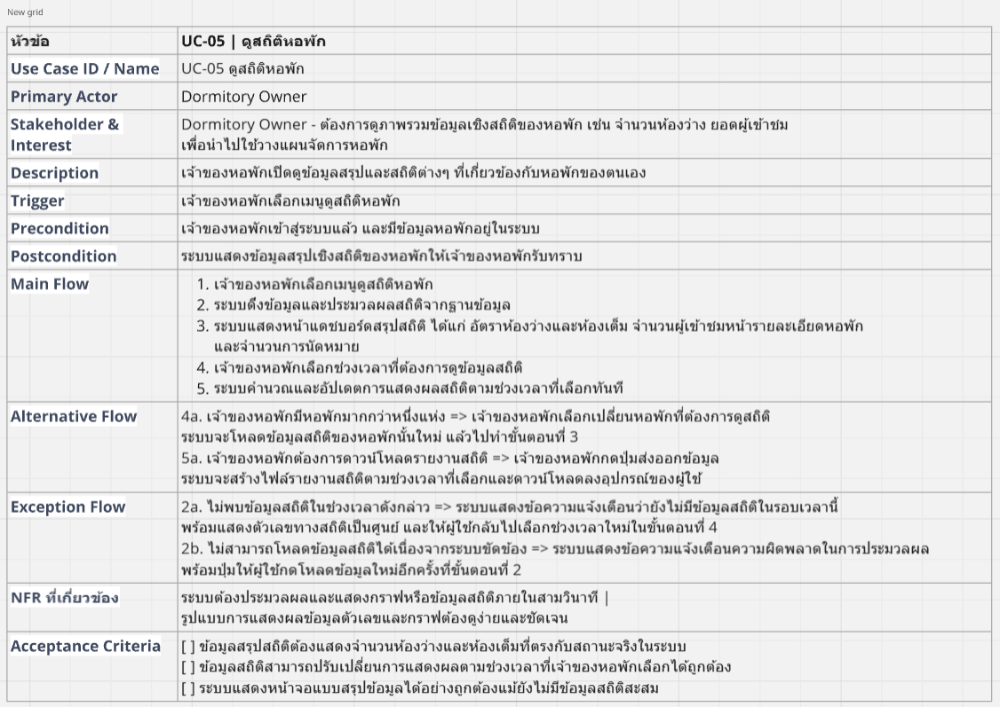

**ผู้รับผิดชอบ:** 660710709 ธนกฤต เวทยนุกูล

UC-06 | นัดหมายดูห้องพัก

**ผู้รับผิดชอบ:** 660710709 ธนกฤต เวทยนุกูล

UC-07 | เข้าสู่ระบบ

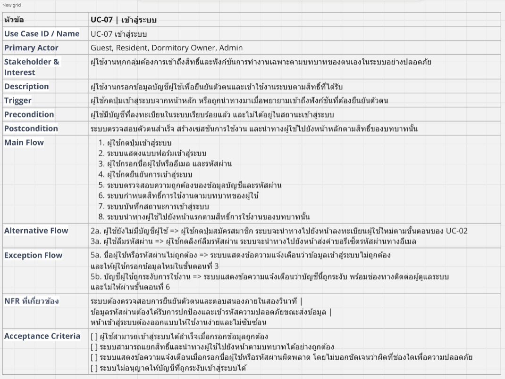

**ผู้รับผิดชอบ:** 660710709 ธนกฤต เวทยนุกูล

UC-08 | จัดการบัญชีผู้ใช้

**ผู้รับผิดชอบ:** 660710709 ธนกฤต เวทยนุกูล

UC-09 | เขียนและแก้ไขรีวิวหอพัก

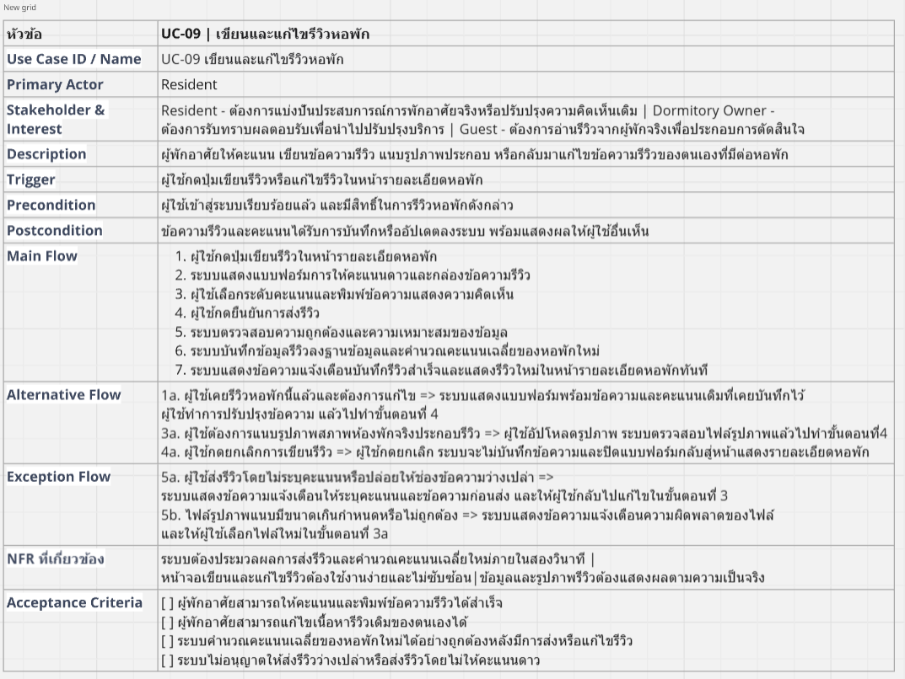

**ผู้รับผิดชอบ:** 660710709 ธนกฤต เวทยนุกูล

UC-10 | แจ้งซ่อม / รายงานปัญหา

**ผู้รับผิดชอบ:** 670710322 ธันยธรณ์ บุญมาก

UC-11 | ดูข้อมูลค่าใช้จ่ายห้องพัก

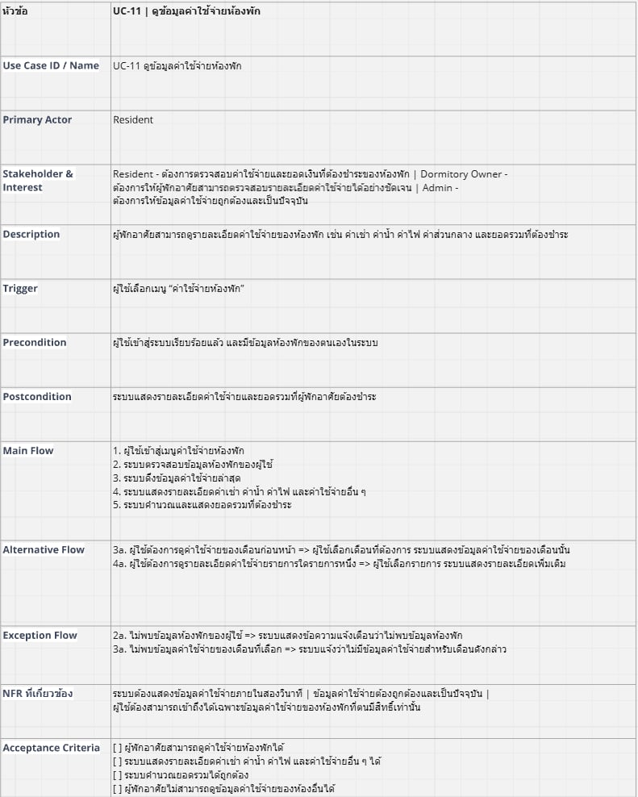

**ผู้รับผิดชอบ:** 670710322 ธันยธรณ์ บุญมาก

UC-12 | จองห้องพัก

**ผู้รับผิดชอบ:** 670710322 ธันยธรณ์ บุญมาก

UC-13 | ตรวจสอบและอนุมัติหอพัก

**ผู้รับผิดชอบ:** 670710322 ธันยธรณ์ บุญมาก

UC-14 | ชำระเงิน

**ผู้รับผิดชอบ:** 670710322 ธันยธรณ์ บุญมาก

---

## 6. ความต้องการเชิงหน้าที่ (Functional Requirements)

### 6.1 Requirement
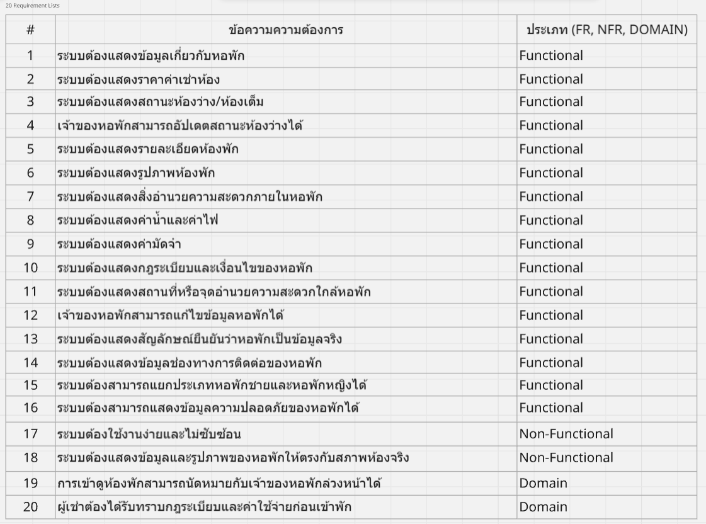

**ผู้รับผิดชอบ** 
670710713 ชนัสถ์นันท์ วะรีวะราช 

### 6.2 Requirements Prioritization

**ผู้รับผิดชอบ** 
660710709 ธนกฤต เวทยนุกูล รับผิดชอบ UC-01 
660710741 ศิริวุฒิ ชัยเกียรติธรรม รับผิดชอบ UC-10, UC-11, UC-12 
670710713 ชนัสถ์นันท์ วะรีวะราช รับผิดชอบ UC-03 
670710322 ธันยธรณ์ บุญมาก รับผิดชอบ UC-13 
670710729 พิทักษ์พล ชยานนท์นุรักษ์ UC-06 

### 6.3 รายการ Functional Requirements ของแต่ละ Use Case
<!-- TODO: ใส่ข้อมูล Usecase ที่ตัวเองทำทั้งหมด -->
<!-- ที่มาคือใส่รหัสหลักฐาน และ AC ทำจากหัวข้อที่ 8 ก่อนแล้วค่อยมาใส่ที่เกี่ยวข้อง -->

UC-01 | ค้นหาและดูข้อมูลหอพัก

| รหัส | # ในรูป | ข้อกำหนด | UC | ลำดับความสำคัญ | ที่มา | AC | Prototype |
|---|---|---|---|---|---|---|---|
| FR-DOR-01 | 1, 2, 15 | ระบบต้องค้นหาและแสดงรายการหอพักตามคำค้น (ชื่อหรือทำเล) และตัวกรอง (ประเภทหอพัก, ช่วงราคา) | UC-01 | Must | INT-01 ข้อ 3.1, ข้อ 5.1 | AC-DOR-01 | ✅ |
| FR-DOR-02 | 3 | ระบบต้องแสดงสถานะห้องว่างหรือห้องเต็มให้ตรงกับฐานข้อมูลล่าสุด | UC-01 | Must | INT-01 ข้อ 2.1, 3.1, 3.3 | AC-DOR-01 | ✅ |
| FR-DOR-03 | 1, 2, 5, 7, 8, 9, 10, 14, 16 | ระบบต้องแสดงหน้ารายละเอียด: ราคา สิ่งอำนวยความสะดวก ค่าน้ำ-ค่าไฟ ค่ามัดจำ กฎระเบียบ ความปลอดภัย ช่องทางติดต่อ | UC-01 | Must | INT-01 ข้อ 3.2 | AC-DOR-02 | ✅ |
| FR-DOR-04 | 6, 11 | ระบบต้องแสดงแกลเลอรีรูปภาพห้องพัก และสถานที่/จุดอำนวยความสะดวกใกล้เคียง | UC-01 | Should | | AC-DOR-02 | ✅ |
| FR-DOR-05 | 13 | ระบบต้องแสดงสัญลักษณ์ยืนยันข้อมูลจริง (Verified Badge) | UC-01 | Must | | AC-DOR-02 | ✅ |
| FR-DOR-06 | ไม่อยู่ในรูป | เมื่อกดล้างตัวกรอง ระบบต้องรีเซ็ตเงื่อนไขเป็นค่าเริ่มต้นและโหลดรายการทั้งหมดทันที | UC-01 | Should | วิเคราะห์โดยทีม (UC-01 Alt 2) | AC-DOR-04 | ✅ |
| FR-DOR-07 | 1, 2, 15 | เมื่อค้นหาไม่พบ ระบบต้องแจ้งเตือนและเสนอหอพักใกล้เคียง/แนะนำ ไม่แสดงหน้าว่าง | UC-01 | Should | วิเคราะห์โดยทีม (UC-01 Exc 5a) | AC-DOR-03 | ✅ |
| FR-DOR-08 | ไม่อยู่ในรูป | เมื่อโหลดรายละเอียดผิดพลาด ระบบต้องแสดงข้อความแจ้งเตือนและปุ่มลองใหม่ | UC-01 | Should | วิเคราะห์โดยทีม (UC-01 Exc 7a) | AC-DOR-05 | ✅ |

UC-02 | สมัครสมาชิก

| รหัส | # ในรูป | ข้อกำหนด | UC | ลำดับความสำคัญ | ที่มา | AC | Prototype |
|---|---|---|---|---|---|---|---|
| FR-REG-01 | ไม่อยู่ในรูป | ระบบต้องแสดงแบบฟอร์มลงทะเบียน (ชื่อ-นามสกุล, อีเมล, เบอร์โทรศัพท์, รหัสผ่าน, ยืนยันรหัสผ่าน) โดยชื่อ-นามสกุลเป็นข้อมูลจำเป็น | UC-02 | Must | วิเคราะห์โดยทีม (UC-02 ขั้น 2) | AC-REG-01 | - |
| FR-REG-02 | ไม่อยู่ในรูป | ระบบต้องตรวจสอบข้อมูลแบบ Inline Validation หลังออกจากแต่ละช่อง และตรวจซ้ำเมื่อกดยืนยัน (รูปแบบอีเมล รูปแบบเบอร์โทรศัพท์ ความยาวรหัสผ่าน รหัสผ่านสองช่องตรงกัน) | UC-02 | Must | วิเคราะห์โดยทีม (UC-02 ขั้น 4) | AC-REG-01, AC-REG-02 | - |
| FR-REG-03 | ไม่อยู่ในรูป | เมื่อตรวจสอบผ่านและข้อมูลไม่ซ้ำ ระบบต้องบันทึกบัญชีใหม่พร้อมเข้ารหัสผ่าน | UC-02 | Must | วิเคราะห์โดยทีม (UC-02 ขั้น 5) | AC-REG-01 | - |
| FR-REG-04 | ไม่อยู่ในรูป | เมื่อบันทึกสำเร็จ ระบบต้องนำทางไปหน้าเข้าสู่ระบบและแสดงข้อความ "สมัครสมาชิกสำเร็จ" | UC-02 | Must | วิเคราะห์โดยทีม (UC-02 ขั้น 6) | AC-REG-01 | - |
| FR-REG-05 | ไม่อยู่ในรูป | เมื่อกดลิงก์ "มีบัญชีอยู่แล้ว? เข้าสู่ระบบ" ระบบต้องนำทางไปหน้าเข้าสู่ระบบ (UC-07) ทันที | UC-02 | Should | วิเคราะห์โดยทีม (UC-02 Alt 1a) | AC-REG-04 | - |
| FR-REG-06 | ไม่อยู่ในรูป | เมื่อข้อมูลจำเป็นไม่ครบหรือรหัสผ่านไม่ตรงกัน ระบบต้องแสดงข้อความแจ้งเตือนที่จุดผิดพลาดและให้แก้ไขได้ | UC-02 | Should | วิเคราะห์โดยทีม (UC-02 Exc 4a) | AC-REG-02 | - |
| FR-REG-07 | ไม่อยู่ในรูป | เมื่ออีเมลหรือเบอร์โทรศัพท์ซ้ำ ระบบต้องแสดงข้อความที่ช่องที่ซ้ำ พร้อมลิงก์เข้าสู่ระบบ ไม่สร้างบัญชีซ้ำ และหากซ้ำทั้งสองค่าต้องแสดงข้อผิดพลาดทั้งสองช่อง | UC-02 | Must | วิเคราะห์โดยทีม (UC-02 Exc 4b) | AC-REG-03 | - |

UC-05 | ดูสถิติหอพัก

| รหัส | # ในรูป | ข้อกำหนด | UC | ลำดับความสำคัญ | ที่มา | AC | Prototype |
|---|---|---|---|---|---|---|---|
| FR-STAT-01 | ไม่อยู่ในรูป | ระบบต้องแสดงเมนูดูสถิติหอพัก | UC-05 | Must | วิเคราะห์โดยทีม (SPEC-STAT-001) | AC-STAT-01 | ✅ |
| FR-STAT-02 | ไม่อยู่ในรูป | ระบบต้องแสดงจำนวนห้องว่าง จำนวนห้องเต็ม จำนวนผู้เข้าชมหน้ารายละเอียดหอพัก และจำนวนการนัดหมายใน Summary Cards และแสดงกราฟแท่งตามข้อมูลสถิติ; ผู้เข้าชมและการนัดหมายใน Prototype เป็นข้อมูลจำลอง เนื่องจากยังไม่มีแหล่งข้อมูลจริง | UC-05 | Must | วิเคราะห์โดยทีม (SPEC-STAT-001) | AC-STAT-01 | ✅ |
| FR-STAT-03 | ไม่อยู่ในรูป | ระบบต้องแสดงจำนวนห้องพักและสถานะห้องว่าง/ห้องเต็ม | UC-05 | Must | วิเคราะห์โดยทีม (SPEC-STAT-001) | AC-STAT-02 | ✅ |
| FR-STAT-04 | ไม่อยู่ในรูป | ผู้ใช้สามารถเลือกช่วงวันที่เริ่มต้นและวันที่สิ้นสุดในรูปแบบ YYYY-MM-DD โดยนับรวมทั้งสองวัน และหากวันที่สิ้นสุดก่อนวันที่เริ่มต้น ระบบต้องไม่อนุญาตให้ค้นหาและแจ้งเตือน | UC-05 | Must | วิเคราะห์โดยทีม (SPEC-STAT-001) | AC-STAT-03 | ✅ |
| FR-STAT-05 | ไม่อยู่ในรูป | ระบบต้องแสดงสถิติที่มีข้อมูลตามช่วงวันที่ที่เลือก และแสดงจำนวนห้องว่าง/ห้องเต็มตามสถานะปัจจุบัน | UC-05 | Must | วิเคราะห์โดยทีม (SPEC-STAT-001) | AC-STAT-03 | ✅ |
| FR-STAT-06 | ไม่อยู่ในรูป | หากไม่มีข้อมูลในช่วงวันที่เลือก ระบบต้องแจ้งว่า “ยังไม่มีข้อมูลสถิติในรอบเวลานี้” และให้เลือกช่วงเวลาใหม่; หากมีข้อมูลแต่ตัวชี้วัดเป็น 0 ต้องแสดงค่า 0 | UC-05 | Must | วิเคราะห์โดยทีม (SPEC-STAT-001) | AC-STAT-04 | ✅ |
| FR-STAT-07 | ไม่อยู่ในรูป | ระบบต้องให้เจ้าของหอพักดาวน์โหลดรายงานสถิติเป็นไฟล์ CSV ตามช่วงวันที่ที่เลือกเมื่อมีข้อมูลในช่วงนั้น; เมื่อไม่มีข้อมูล ระบบต้องไม่อนุญาตให้ดาวน์โหลดและต้องแจ้งผู้ใช้ว่าไม่สามารถดาวน์โหลดได้เนื่องจากไม่มีข้อมูลในช่วงเวลาที่เลือก | UC-05 | Should | วิเคราะห์โดยทีม (SPEC-STAT-001) | AC-STAT-05 | ✅ |

UC-06 | นัดหมายดูห้องพัก

| รหัส | # ในรูป | ข้อกำหนด | UC | ลำดับความสำคัญ | ที่มา | AC | Prototype |
|---|---|---|---|---|---|---|---|
| FR-APPT-01 | 19 | ระบบต้องแสดงเมนูนัดหมายดูห้องพักในหน้ารายละเอียดหอพัก | UC-06 | Must | Req #19; INT-01 ข้อ 2.2 (ปัจจุบันเจ้าของนัดเวลาพาดูห้อง) | AC-APPT-01 | - |
| FR-APPT-02 | 19 | ระบบต้องแสดงแบบฟอร์ม ปฏิทิน และช่วงเวลาที่ว่างในหน้าเดียว โดยแสดงเฉพาะช่วงเวลาที่นัดหมายได้ ไม่ให้เลือกช่วงที่ถูกจองแล้ว และกำหนดแต่ละรอบยาว 30 นาที | UC-06 | Must | Req #19; INT-01 ข้อ 2.2 | AC-APPT-01, AC-APPT-02 | - |
| FR-APPT-03 | 19 | ผู้ใช้เลือกได้หนึ่งช่วงเวลา (เวลาเริ่มต้นและสิ้นสุด) ต่อหนึ่งคำขอ โดยระบบกำหนดเวลาให้ตรงตามรอบ 30 นาทีที่อนุญาต | UC-06 | Must | Req #19; INT-01 ข้อ 2.2 | AC-APPT-02 | - |
| FR-APPT-04 | 19 | ผู้ใช้เปลี่ยนเดือนหรือวันเพื่อดูช่วงเวลาว่างของวันที่เลือกได้ และระบบไม่ให้เลือกช่วงเวลาที่นัดหมายไม่ได้ | UC-06 | Should | วิเคราะห์โดยทีม (SPEC-APPT-001) | AC-APPT-02 | - |
| FR-APPT-05 | 19 | ก่อนส่งคำขอ ระบบต้องตรวจสอบวันและเวลา และอนุญาตเฉพาะวันจันทร์–เสาร์ เวลา 09:00–18:00 น. | UC-06 | Must | วิเคราะห์โดยทีม (SPEC-APPT-001) | AC-APPT-03 | - |
| FR-APPT-06 | 19 | ระบบต้องป้องกันคำขอที่ช่วงเวลาทับซ้อนกับการนัดหมายที่มีอยู่ในหอพักเดียวกัน | UC-06 | Must | วิเคราะห์โดยทีม (SPEC-APPT-001) | AC-APPT-03 | - |
| FR-APPT-07 | 19 | ระบบต้องไม่อนุญาตให้เลือกวันที่ผ่านมาแล้ว วันอาทิตย์ หรือเวลานอกช่วงเวลานัดหมาย | UC-06 | Must | วิเคราะห์โดยทีม (SPEC-APPT-001) | AC-APPT-03 | - |
| FR-APPT-08 | 19 | ระบบต้องบันทึกข้อมูลการนัดหมายเมื่อผู้ใช้ส่งคำขอสำเร็จ | UC-06 | Must | Req #19; INT-01 ข้อ 2.2 | AC-APPT-04 | - |
| FR-APPT-09 | 19 | ระบบต้องแจ้งเจ้าของหอพักเมื่อมีคำขอนัดหมาย; หากแจ้งไม่สำเร็จ ต้องบันทึกคำขอไว้และแจ้งผู้ใช้ว่าการแจ้งเตือนไม่สำเร็จ; ช่องทางการแจ้งเตือนเจ้าของหอพักยังต้องยืนยัน | UC-06 | Must | วิเคราะห์โดยทีม (SPEC-APPT-001) | AC-APPT-04 | - |
| FR-APPT-10 | 19 | เมื่อส่งคำขอสำเร็จ ระบบต้องแสดงข้อความยืนยันพร้อมวันและเวลานัดหมาย | UC-06 | Should | วิเคราะห์โดยทีม (SPEC-APPT-001) | AC-APPT-05 | - |
| FR-APPT-11 | 19 | หากผู้ใช้ยกเลิกก่อนยืนยันส่งคำขอ ระบบต้องไม่บันทึกการนัดหมายและนำกลับไปหน้ารายละเอียดหอพัก | UC-06 | Should | วิเคราะห์โดยทีม (SPEC-APPT-001) | AC-APPT-06 | - |

 

UC-07 | เข้าสู่ระบบ

| รหัส | # ในรูป | ข้อกำหนด | UC | ลำดับความสำคัญ | ที่มา | AC | Prototype |
|---|---|---|---|---|---|---|---|
| FR-LOG-01 | ไม่อยู่ในรูป | ระบบต้องแสดงแบบฟอร์มเข้าสู่ระบบ ประกอบด้วยอีเมลหรือชื่อผู้ใช้ และรหัสผ่าน | UC-07 | Must | วิเคราะห์โดยทีม (UC-07 ขั้น 1-2) | AC-LOG-01 | - |
| FR-LOG-02 | ไม่อยู่ในรูป | ระบบต้องตรวจสอบว่าผู้ใช้กรอกข้อมูลเข้าสู่ระบบครบถ้วนก่อนส่งข้อมูล | UC-07 | Must | วิเคราะห์โดยทีม (UC-07 ขั้น 2-3) | AC-LOG-01 | - |
| FR-LOG-03 | ไม่อยู่ในรูป | เมื่อผู้ใช้ยืนยันการเข้าสู่ระบบ ระบบต้องตรวจสอบอีเมลหรือชื่อผู้ใช้และรหัสผ่านกับฐานข้อมูล | UC-07 | Must | วิเคราะห์โดยทีม (UC-07 ขั้น 3-4) | AC-LOG-02 | - |
| FR-LOG-04 | ไม่อยู่ในรูป | เมื่อเข้าสู่ระบบสำเร็จ ระบบต้องกำหนดสิทธิ์การใช้งานตามบทบาทของผู้ใช้ | UC-07 | Must | วิเคราะห์โดยทีม (UC-07 ขั้น 5) | AC-LOG-03 | - |
| FR-LOG-05 | ไม่อยู่ในรูป | เมื่อเข้าสู่ระบบสำเร็จ ระบบต้องบันทึกสถานะการเข้าสู่ระบบของผู้ใช้ | UC-07 | Must | วิเคราะห์โดยทีม (UC-07 ขั้น 6) | AC-LOG-02 | - |
| FR-LOG-06 | ไม่อยู่ในรูป | เมื่อเข้าสู่ระบบสำเร็จ ระบบต้องนำผู้ใช้ไปยังหน้าหลักตามบทบาทและสิทธิ์ที่ได้รับ | UC-07 | Must | วิเคราะห์โดยทีม (UC-07 ขั้น 7-8) | AC-LOG-03 | - |
| FR-LOG-07 | ไม่อยู่ในรูป | เมื่อกดลิงก์สมัครสมาชิก ระบบต้องนำทางไปยังหน้าสมัครสมาชิก (UC-02) | UC-07 | Should | วิเคราะห์โดยทีม (UC-07 Alt) | AC-LOG-04 | - |
| FR-LOG-08 | ไม่อยู่ในรูป | เมื่อผู้ใช้กรอกข้อมูลไม่ถูกต้อง ระบบต้องแสดงข้อความแจ้งเตือนและให้ผู้ใช้ลองเข้าสู่ระบบใหม่ได้ | UC-07 | Must | วิเคราะห์โดยทีม (UC-07 Exc) | AC-LOG-05 | - |
| FR-LOG-09 | ไม่อยู่ในรูป | เมื่อบัญชีผู้ใช้ถูกระงับ ระบบต้องปฏิเสธการเข้าสู่ระบบและแจ้งเตือนผู้ใช้ | UC-07 | Must | วิเคราะห์โดยทีม (UC-07 Exc) | AC-LOG-06 | - |

UC-08 | จัดการบัญชีผู้ใช้

| รหัส | # ในรูป | ข้อกำหนด | UC | ลำดับความสำคัญ | ที่มา | AC | Prototype |
|---|---|---|---|---|---|---|---|
| FR-ACC-01 | ไม่อยู่ในรูป | ระบบต้องแสดงรายการบัญชีผู้ใช้ พร้อมข้อมูลชื่อ-นามสกุล อีเมล เบอร์โทรศัพท์ และบทบาทของผู้ใช้ | UC-08 | Must | วิเคราะห์โดยทีม (UC-08 ขั้น 1) | AC-ACC-01 | - |
| FR-ACC-02 | ไม่อยู่ในรูป | ระบบต้องอนุญาตให้ผู้ดูแลระบบค้นหาบัญชีผู้ใช้จากชื่อ อีเมล หรือเบอร์โทรศัพท์ | UC-08 | Must | วิเคราะห์โดยทีม (UC-08 ขั้น 2) | AC-ACC-02 | - |
| FR-ACC-03 | ไม่อยู่ในรูป | ระบบต้องแสดงสถานะบัญชีผู้ใช้ เช่น เปิดใช้งานหรือระงับบัญชี | UC-08 | Must | วิเคราะห์โดยทีม (UC-08 ขั้น 2-3) | AC-ACC-01 | - |
| FR-ACC-04 | ไม่อยู่ในรูป | ระบบต้องอนุญาตให้ผู้ดูแลระบบแก้ไขข้อมูลบัญชีผู้ใช้ตามสิทธิ์ที่กำหนด | UC-08 | Must | วิเคราะห์โดยทีม (UC-08 ขั้น 4) | AC-ACC-03 | - |
| FR-ACC-05 | ไม่อยู่ในรูป | เมื่อผู้ดูแลระบบยืนยันการแก้ไข ระบบต้องบันทึกข้อมูลบัญชีที่เปลี่ยนแปลงลงฐานข้อมูล | UC-08 | Must | วิเคราะห์โดยทีม (UC-08 ขั้น 5) | AC-ACC-03 | - |
| FR-ACC-06 | ไม่อยู่ในรูป | ระบบต้องอนุญาตให้ผู้ดูแลระบบเปลี่ยนสถานะบัญชีผู้ใช้ เช่น เปิดใช้งานหรือระงับบัญชี | UC-08 | Must | วิเคราะห์โดยทีม (UC-08 ขั้น 6) | AC-ACC-04 | - |
| FR-ACC-07 | ไม่อยู่ในรูป | เมื่อบัญชีผู้ใช้ถูกระงับ ระบบต้องป้องกันไม่ให้บัญชีดังกล่าวเข้าสู่ระบบได้ | UC-08 | Must | วิเคราะห์โดยทีม (UC-08 Alt) | AC-ACC-04 | - |
| FR-ACC-08 | ไม่อยู่ในรูป | ก่อนเปลี่ยนสถานะบัญชี ระบบต้องแสดงข้อความยืนยันการดำเนินการ | UC-08 | Should | วิเคราะห์โดยทีม (UC-08 ขั้น 4-6) | AC-ACC-05 | - |
| FR-ACC-09 | ไม่อยู่ในรูป | เมื่อบันทึกข้อมูลสำเร็จ ระบบต้องแสดงข้อความแจ้งผลการดำเนินการและปรับปรุงรายการบัญชีให้เป็นข้อมูลล่าสุด | UC-08 | Must | วิเคราะห์โดยทีม (UC-08 ขั้น 7) | AC-ACC-03, AC-ACC-04 | - |
| FR-ACC-10 | ไม่อยู่ในรูป | เมื่อเกิดข้อผิดพลาดในการโหลดหรือบันทึกข้อมูลบัญชี ระบบต้องแสดงข้อความแจ้งเตือนและให้ผู้ดูแลระบบลองใหม่ได้ | UC-08 | Should | วิเคราะห์โดยทีม (UC-08 Exc) | AC-ACC-06 | - |

### 6.4 Requirement Smells

UC-01 | ค้นหาและดูข้อมูลหอพัก

**ผู้รับผิดชอบ:** 660710709 ธนกฤต เวทยนุกูล

UC-02 | สมัครสมาชิก

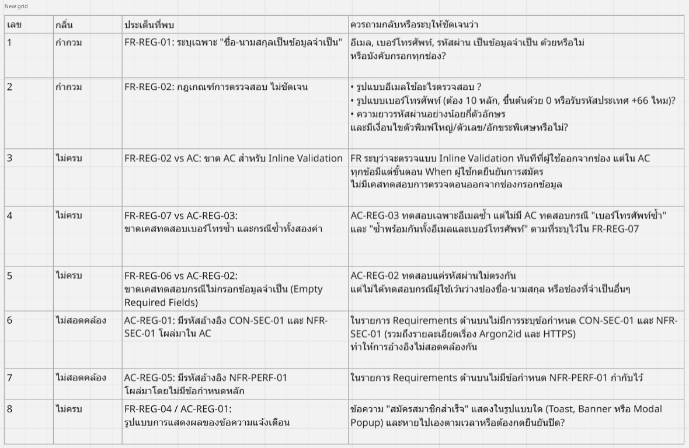

**ผู้รับผิดชอบ:** 660710709 ธนกฤต เวทยนุกูล

UC-03 | จัดการข้อมูลหอพัก

**ผู้รับผิดชอบ:** 670710713 ชนัสถ์นันท์ วะรีวะราช

UC-04 | อัพเดทสถานะห้องว่าง

**ผู้รับผิดชอบ:** 670710713 ชนัสถ์นันท์ วะรีวะราช

UC-05 | ดูสถิติหอพัก

**ผู้รับผิดชอบ:** 670710729 พิทักษ์พล ชยานนท์นุรักษ์ 

UC-06 | นัดหมายดูห้องพัก

**ผู้รับผิดชอบ:** 670710729 พิทักษ์พล ชยานนท์นุรักษ์ 

UC-07 | เข้าสู่ระบบ

**ผู้รับผิดชอบ:** 670710746 ณัฎฐพล ดาเจริญ

UC-08 | จัดการบัญชีผู้ใช้

**ผู้รับผิดชอบ:** 670710746 ณัฎฐพล ดาเจริญ

UC-09 | เขียนและแก้ไขรีวิวหอพัก

**ผู้รับผิดชอบ:** 670710713 ชนัสถ์นันท์ วะรีวะราช

UC-10 | แจ้งซ่อม / รายงานปัญหา

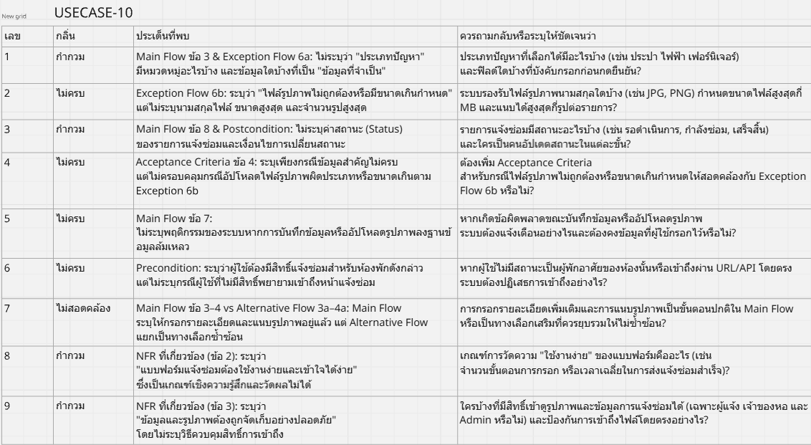

**ผู้รับผิดชอบ:** 660710741 ศิริวุฒิ ชัยเกียรติธรรม

UC-11 | ดูข้อมูลค่าใช้จ่ายห้องพัก

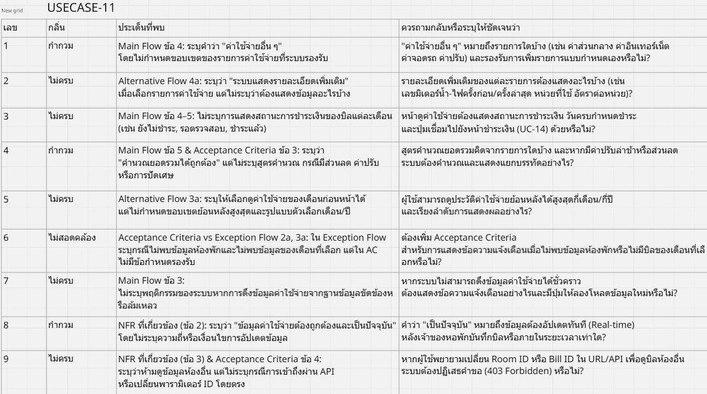

**ผู้รับผิดชอบ:** 660710741 ศิริวุฒิ ชัยเกียรติธรรม

UC-12 | จองห้องพัก

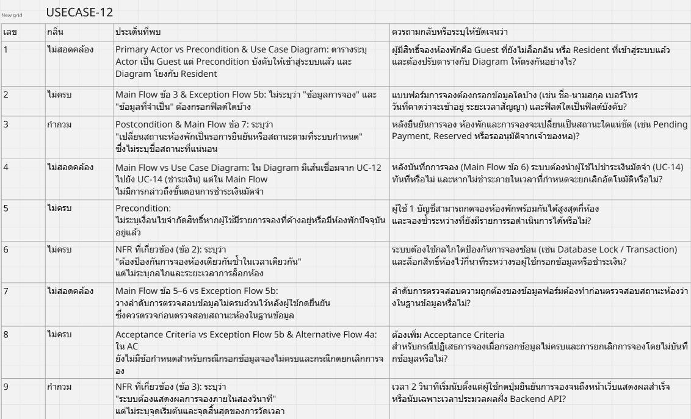

**ผู้รับผิดชอบ:** 660710741 ศิริวุฒิ ชัยเกียรติธรรม

UC-13 | ตรวจสอบและอนุมัติหอพัก

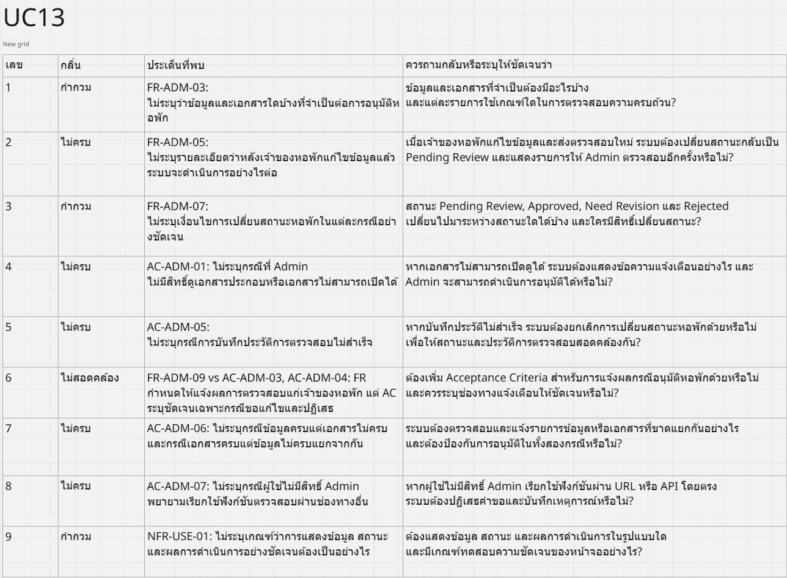

**ผู้รับผิดชอบ:** 670710322 ธันยธรณ์ บุญมาก

UC-14 | ชำระเงิน

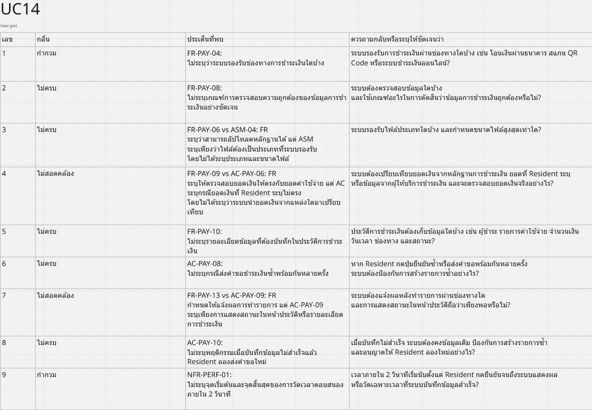

**ผู้รับผิดชอบ:** 670710322 ธันยธรณ์ บุญมาก

## 7. ความต้องการที่ไม่ใช่เชิงหน้าที่ (Non-Functional Requirements)
<!-- TODO: ใส่ข้อมูล Usecase ที่ตัวเองทำทั้งหมด -->

UC-01 | ค้นหาและดูข้อมูลหอพัก

| รหัส | หมวด | ข้อกำหนด | เกณฑ์วัด | วิธีตรวจ | ที่มา |
|---|---|---|---|---|---|
| NFR-USE-01 | ความสามารถในการใช้งาน | หน้าค้นหา ตัวกรอง และการจัดวางข้อมูลในหน้ารายละเอียดต้องใช้งานง่าย ไม่ซับซ้อน | ผู้ใช้ทั่วไป 5 คน ทำงานค้นหา/กรองหอพัก ล้างตัวกรอง และเปิดดูรายละเอียด แต่ละงานต้องมีผู้ทำสำเร็จโดยไม่รับความช่วยเหลืออย่างน้อย 4 ใน 5 คน | ทดสอบกับผู้ใช้ 5 คน (ยังไม่มี AC และ test case รองรับ) | Req #17 |
| NFR-ACC-01 | ความน่าเชื่อถือ (ความถูกต้องของข้อมูล) | ข้อมูล ราคา และรูปภาพของหอพักต้องตรงกับสภาพห้องและเงื่อนไขจริง | spec ยังไม่กำหนดเกณฑ์วัด | AC-DOR-02, TC-DOR-02-1; T-08 ตรวจว่าข้อมูลที่แสดงตรงกับข้อมูลตัวอย่างที่เตรียมไว้ | Req #18 |
| NFR-PERF-01 | ประสิทธิภาพ | การค้นหาและแสดงผลรายละเอียดหอพักต้องตอบสนองเร็ว | เวลาตอบสนอง p95 ไม่เกิน 3 วินาทีในสภาวะเครือข่ายปกติ (วัดจาก response ของ API ค้นหาและรายละเอียด) | AC-DOR-06, TC-DOR-06-1 ถึง 06-3, T-15 (pytest) | วิเคราะห์โดยทีม (UC-01) |
| NFR-SEC-01 | ความปลอดภัย | ข้อมูลที่รับส่งระหว่างเบราว์เซอร์และระบบต้องเข้ารหัส | ใช้ HTTPS (TLS 1.2 ขึ้นไป) | T-16 ตรวจใน deployment environment (ยังไม่มี AC; task ถูก block รอ environment) | วิเคราะห์โดยทีม (UC-01) |

UC-02 | สมัครสมาชิก

| รหัส | หมวด | ข้อกำหนด | เกณฑ์วัด | วิธีตรวจ | ที่มา |
|---|---|---|---|---|---|
| NFR-USE-01 | ความสามารถในการใช้งาน | แบบฟอร์มสมัครสมาชิกต้องใช้งานง่ายและให้ข้อความผิดพลาดที่เข้าใจได้ | ป้ายกำกับตรงกับข้อมูลที่รับ, มีข้อความผิดพลาดที่ช่องที่เกี่ยวข้อง, แสดง Inline Validation หลังผู้ใช้ออกจากช่อง (ตรวจว่ามีครบ ไม่ใช่ตัวเลข) | AC-REG-02 (ตรวจเฉพาะกรณีรหัสผ่านไม่ตรงกัน ยังไม่ครอบคลุมเกณฑ์ทั้งหมด) | Req #17 |
| NFR-SEC-01 | ความปลอดภัย | การรับส่งข้อมูลลงทะเบียนต้องเข้ารหัสและไม่เก็บรหัสผ่านแบบอ่านได้ | ใช้ HTTPS (TLS 1.2 ขึ้นไป) และไม่บันทึกรหัสผ่านเป็น Plain Text (ตามข้อจำกัด CON-SEC-01 รหัสผ่านแฮชด้วย Argon2id) | AC-REG-01 | วิเคราะห์โดยทีม (UC-02) |
| NFR-PERF-01 | ประสิทธิภาพ | ระบบต้องตอบสนองการสมัครสมาชิกอย่างรวดเร็ว | วัดตั้งแต่ผู้ใช้กดยืนยันจนระบบตอบกลับและบันทึกข้อมูล เวลา p95 ไม่เกิน 2 วินาทีในสภาวะเครือข่ายปกติ | AC-REG-05 | วิเคราะห์โดยทีม (UC-02) |

UC-05 | ดูสถิติหอพัก

| รหัส | หมวด | ข้อกำหนด | เกณฑ์วัด | วิธีตรวจ | ที่มา |
|---|---|---|---|---|---|
| NFR-STAT-USE-01 | ความสามารถในการใช้งาน | ข้อมูลสถิติต้องอ่านได้บนโทรศัพท์ แท็บเล็ต และเดสก์ท็อป | ตรวจข้อมูลตาม FR-STAT-02 และ FR-STAT-03 บนทั้ง 3 ประเภทอุปกรณ์ โดยค่าหรือป้ายกำกับไม่ถูกตัดหรือทับซ้อน | ตรวจหน้าสถิติที่ขนาดหน้าจอโทรศัพท์ แท็บเล็ต และเดสก์ท็อป | UC-05, SPEC-STAT-001 |
| NFR-STAT-PERF-01 | ประสิทธิภาพ | ระบบต้องประมวลผลและแสดงข้อมูลหรือกราฟสถิติภายใน 3 วินาทีหลังยืนยันช่วงวันที่ | ไม่เกิน 3 วินาทีตั้งแต่ยืนยันช่วงวันที่จนแสดงข้อมูลสถิติครบ | วัดเวลาตั้งแต่ยืนยันช่วงวันที่จน Summary Cards และกราฟแสดงครบ | UC-05, SPEC-STAT-001 |
| CON-STAT-AUTH-01 | ความปลอดภัย | เฉพาะเจ้าของหอพักที่เข้าสู่ระบบและเป็นเจ้าของข้อมูลจึงดูสถิติได้ | คำขอที่ไม่มีข้อมูลเจ้าของหรือใช้เจ้าของที่ไม่ตรงกับหอพักต้องถูกปฏิเสธและไม่เปิดเผยสถิติ | ตรวจคำขอโดยไม่ส่ง X-Owner-Id และโดยส่งรหัสเจ้าของที่ไม่ตรงกับหอพัก | UC-05, SPEC-STAT-001 |

UC-06 | นัดหมายดูห้องพัก

| รหัส | หมวด | ข้อกำหนด | เกณฑ์วัด | วิธีตรวจ | ที่มา |
|---|---|---|---|---|---|
| NFR-APPT-USE-01 | ความสามารถในการใช้งาน | แบบฟอร์มนัดหมายต้องใช้งานไม่ซับซ้อน และแสดงแบบฟอร์ม ปฏิทิน และช่วงเวลาว่างในหน้าเดียว | เป้าหมายที่เสนอ (รอยืนยัน): อย่างน้อย 4 ใน 5 ผู้ทดสอบสามารถเลือกช่วงเวลาว่างและส่งคำขอที่ถูกต้องได้โดยไม่ขอความช่วยเหลือ ภายใน 3 นาที | เมื่อมี Prototype ให้ทดสอบกับผู้ใช้ 5 คนและบันทึกจำนวนผู้ทำสำเร็จโดยไม่ช่วยเหลือกับเวลาที่ใช้; ยังไม่มีผลทดสอบ | UC-06, SPEC-APPT-001 |
| NFR-APPT-PERF-01 | ประสิทธิภาพ | ระบบต้องตรวจสอบและบันทึกคำขอนัดหมายภายใน 3 วินาทีหลังผู้ใช้ยืนยันส่งคำขอ | เป้าหมายตาม SPEC-APPT-001: ไม่เกิน 3 วินาทีตั้งแต่ยืนยันส่งคำขอจนตรวจสอบและบันทึกเสร็จ | เมื่อมีระบบให้วัดเวลาตั้งแต่ยืนยันส่งคำขอจนได้รับผลการบันทึก; ยังไม่มีผลทดสอบ | UC-06, SPEC-APPT-001 |
| CON-APPT-AUTH-01 | ความปลอดภัย | ผู้ใช้ต้องเข้าสู่ระบบก่อนจึงจะส่งคำขอนัดหมายได้ | คำขอที่ไม่มี session ต้องถูกปฏิเสธและไม่มีการบันทึกการนัดหมาย | เมื่อเชื่อม session ของ UC-07 แล้ว ให้ทดสอบส่งคำขอโดยไม่มี session และตรวจผลการปฏิเสธกับข้อมูลที่บันทึก | UC-06, SPEC-APPT-001; UC-07, SPEC-LOGIN-001 |

 

UC-07 | เข้าสู่ระบบ

| รหัส | หมวด | ข้อกำหนด | เกณฑ์วัด | วิธีตรวจ | ที่มา |
|---|---|---|---|---|---|
| NFR-USE-02 | ความสามารถในการใช้งาน | หน้าเข้าสู่ระบบต้องใช้งานง่าย มีป้ายกำกับช่องกรอกข้อมูลชัดเจน และแจ้งข้อผิดพลาดให้ผู้ใช้เข้าใจได้ | ช่องอีเมลหรือชื่อผู้ใช้และรหัสผ่านต้องมีป้ายกำกับชัดเจน และเมื่อกรอกข้อมูลผิดต้องมีข้อความแจ้งเตือน | ทดสอบการเข้าสู่ระบบด้วยข้อมูลถูกต้องและไม่ถูกต้อง ตรวจสอบการแสดงข้อความแจ้งเตือน | Req #17 |
| NFR-SEC-02 | ความปลอดภัย | ระบบต้องป้องกันการเข้าถึงบัญชีโดยไม่ได้รับอนุญาต และต้องไม่จัดเก็บรหัสผ่านในรูปแบบ Plain Text | รหัสผ่านต้องผ่านการ Hash ก่อนจัดเก็บ และการเข้าสู่ระบบต้องตรวจสอบข้อมูลกับระบบยืนยันตัวตน | ตรวจสอบการจัดเก็บรหัสผ่านและทดสอบเข้าสู่ระบบด้วยข้อมูลที่ถูกต้องและไม่ถูกต้อง | วิเคราะห์โดยทีม (UC-07) |
| NFR-SEC-03 | ความปลอดภัย | ระบบต้องจำกัดการเข้าถึงหน้าต่าง ๆ ตามบทบาทและสิทธิ์ของผู้ใช้ | ผู้ใช้ที่ไม่มีสิทธิ์ต้องไม่สามารถเข้าถึงหน้าที่สงวนไว้สำหรับ Admin หรือ Dormitory Owner ได้ | ทดสอบเข้าถึงหน้าที่จำกัดสิทธิ์ด้วยบัญชีแต่ละบทบาท | วิเคราะห์โดยทีม (UC-07) |
| NFR-PERF-02 | ประสิทธิภาพ | ระบบต้องตอบสนองการเข้าสู่ระบบอย่างรวดเร็ว | เวลาตอบสนอง p95 ไม่เกิน 2 วินาทีในสภาวะเครือข่ายปกติ | วัดเวลาตั้งแต่ผู้ใช้กดยืนยันเข้าสู่ระบบจนระบบตอบกลับ | วิเคราะห์โดยทีม (UC-07) |
| NFR-REL-01 | ความน่าเชื่อถือ | ระบบต้องจัดการข้อผิดพลาดในการเข้าสู่ระบบโดยไม่ทำให้ระบบหยุดทำงาน | เมื่อเข้าสู่ระบบไม่สำเร็จ ระบบต้องแสดงข้อความแจ้งเตือนและยังสามารถลองเข้าสู่ระบบใหม่ได้ | ทดสอบกรณีรหัสผ่านผิด บัญชีไม่พบ และระบบไม่สามารถเชื่อมต่อฐานข้อมูลได้ | วิเคราะห์โดยทีม (UC-07) |

UC-08 | จัดการบัญชีผู้ใช้

| รหัส | หมวด | ข้อกำหนด | เกณฑ์วัด | วิธีตรวจ | ที่มา |
|---|---|---|---|---|---|
| NFR-USE-03 | ความสามารถในการใช้งาน | หน้าจัดการบัญชีผู้ใช้ต้องแสดงข้อมูลเป็นระเบียบ สามารถค้นหา ตรวจสอบ และแก้ไขบัญชีได้ง่าย | ผู้ดูแลระบบต้องสามารถค้นหาบัญชี ดูรายละเอียด และเปลี่ยนสถานะบัญชีได้โดยไม่ต้องรับความช่วยเหลือ | ทดสอบการใช้งานหน้าจัดการบัญชีผู้ใช้กับผู้ดูแลระบบ | Req #17 |
| NFR-SEC-04 | ความปลอดภัย | ระบบต้องจำกัดการจัดการบัญชีผู้ใช้เฉพาะผู้ดูแลระบบที่ได้รับสิทธิ์เท่านั้น | ผู้ใช้ที่ไม่ใช่ Admin ต้องไม่สามารถเข้าถึงหรือดำเนินการจัดการบัญชีผู้ใช้ได้ | ทดสอบเข้าถึงหน้าจัดการบัญชีด้วยบัญชี Resident, Dormitory Owner และ Admin | วิเคราะห์โดยทีม (UC-08) |
| NFR-SEC-05 | ความปลอดภัย | ระบบต้องป้องกันการแก้ไขข้อมูลบัญชีโดยไม่ได้รับอนุญาต | การแก้ไขข้อมูลและเปลี่ยนสถานะบัญชีต้องผ่านการตรวจสอบสิทธิ์ก่อนดำเนินการ | ทดสอบการส่งคำขอแก้ไขข้อมูลโดยบัญชีที่ไม่มีสิทธิ์ | วิเคราะห์โดยทีม (UC-08) |
| NFR-PERF-03 | ประสิทธิภาพ | ระบบต้องแสดงรายการบัญชีผู้ใช้และผลการค้นหาอย่างรวดเร็ว | เวลาตอบสนอง p95 ไม่เกิน 3 วินาทีในสภาวะเครือข่ายปกติ | วัดเวลาตั้งแต่เรียกดูรายการหรือค้นหาบัญชีจนระบบแสดงผล | วิเคราะห์โดยทีม (UC-08) |
| NFR-REL-02 | ความน่าเชื่อถือ | ระบบต้องรักษาความถูกต้องของข้อมูลบัญชีเมื่อมีการแก้ไขหรือเปลี่ยนสถานะ | เมื่อบันทึกสำเร็จ ข้อมูลที่แสดงต้องตรงกับข้อมูลล่าสุดในฐานข้อมูล และหากบันทึกไม่สำเร็จต้องไม่แสดงผลเสมือนว่าบันทึกสำเร็จ | ทดสอบแก้ไขข้อมูล เปลี่ยนสถานะ และจำลองกรณีบันทึกข้อมูลล้มเหลว | วิเคราะห์โดยทีม (UC-08) |

## 8. Acceptance Criteria
<!-- TODO: ใส่ข้อมูล Usecase ที่ตัวเองทำทั้งหมด -->

UC-01 | ค้นหาและดูข้อมูลหอพัก

- **AC-01.1** ผู้ใช้พิมพ์ค่าค้นหา และกรองตามประเภทหอพักและช่วงราคาได้ถูกต้อง (FR-015)
- **AC-01.2** ผลการค้นหาแสดงสถานะห้องว่าง/เต็มตรงกับฐานข้อมูลล่าสุด (FR-003)
- **AC-01.3** หน้ารายละเอียดหอพักแสดงข้อมูลครบตาม FR-001, 002, 005-011, 014, 016
- **AC-01.4** หอพักที่ผ่านการตรวจสอบแสดงสัญลักษณ์ยืนยันข้อมูลจริงชัดเจน (FR-013)
- **AC-01.5** เมื่อค้นหาไม่พบ ระบบแสดงข้อความแจ้งที่เข้าใจง่าย แทนหน้าว่างเปล่า
- **AC-01.6** เมื่อโหลดรายละเอียดไม่ได้ ระบบแสดงข้อความแจ้งพร้อมปุ่ม "กลับสู่หน้าค้นหา"

UC-02 | สมัครสมาชิก

- **AC-02.1** ผู้ใช้สมัครบัญชีสำเร็จเมื่อกรอกข้อมูลถูกต้องครบถ้วน
- **AC-02.2** ระบบไม่อนุญาตให้ใช้อีเมลหรือเบอร์โทรศัพท์ที่ซ้ำกับในระบบ
- **AC-02.3** ระบบไม่แสดงรหัสผ่านเป็นตัวอักษรธรรมดา และแจ้งเตือนเมื่อรหัสผ่านไม่ตรงกัน

UC-05 | ดูสถิติหอพัก

- **AC-STAT-01** เมื่อเจ้าของหอพักที่เข้าสู่ระบบและเป็นเจ้าของหอพักนั้นเข้าสู่เมนูดูสถิติ ระบบต้องแสดงข้อมูลสรุปจำนวนห้องว่าง ห้องเต็ม ผู้เข้าชมหน้ารายละเอียด และการนัดหมายในรูปแบบ Summary Cards ร่วมกับกราฟแท่ง; ผู้เข้าชมหน้ารายละเอียดและการนัดหมายใน Prototype เป็นข้อมูลจำลองเนื่องจากยังไม่มีแหล่งข้อมูลจริง; หากไม่ได้เข้าสู่ระบบหรือไม่ใช่เจ้าของหอพัก ระบบต้องไม่เปิดเผยข้อมูลสถิติ (FR-STAT-01, FR-STAT-02, CON-STAT-AUTH-01)
- **AC-STAT-02** เมื่อมีข้อมูลห้องพัก ระบบต้องแสดงจำนวนห้องพักและสถานะห้องว่าง/ห้องเต็ม (FR-STAT-03)
- **AC-STAT-03** เมื่อเลือกช่วงวันที่เริ่มต้นและสิ้นสุด ระบบต้องแสดงข้อมูลตามช่วงวันที่รวมทั้งวันเริ่มต้นและวันสิ้นสุด โดยจำนวนห้องว่าง/ห้องเต็มยังเป็นไปตามสถานะปัจจุบัน; หากวันที่สิ้นสุดก่อนวันที่เริ่มต้น ระบบต้องไม่ค้นหาและแจ้งเตือนผู้ใช้ (FR-STAT-04, FR-STAT-05)
- **AC-STAT-04** หากไม่มีข้อมูลในช่วงวันที่เลือก ระบบต้องแจ้งว่า “ยังไม่มีข้อมูลสถิติในรอบเวลานี้” และให้เลือกช่วงเวลาใหม่; หากมีข้อมูลแต่ค่าตัวชี้วัดเป็น 0 ระบบต้องแสดงค่า 0 (FR-STAT-06)
- **AC-STAT-05** เมื่อเจ้าของหอพักกดแสดงสถิติและช่วงวันที่ที่เลือกมีข้อมูลแล้ว เมื่อกดดาวน์โหลดรายงาน ระบบต้องได้ไฟล์ CSV ที่ตรงกับช่วงวันที่เลือก; หากไม่มีข้อมูล ระบบต้องไม่ดาวน์โหลดและต้องแสดงข้อความ “ไม่สามารถดาวน์โหลดรายงานได้เนื่องจากไม่มีข้อมูลในช่วงเวลาที่เลือก” (FR-STAT-07)

UC-06 | นัดหมายดูห้องพัก

**สถานะ:** ยังไม่มี Prototype; AC ต่อไปนี้เป็นเกณฑ์สำหรับทดสอบในอนาคต ไม่ใช่ผลการทดสอบ

- **AC-APPT-01** เมื่อผู้ใช้เข้าสู่ระบบและเปิดเมนูนัดหมายจากหน้ารายละเอียดหอพัก ระบบต้องแสดงแบบฟอร์ม ปฏิทิน และช่วงเวลาว่างในหน้าเดียว; ผู้ใช้ที่ไม่ได้เข้าสู่ระบบต้องไม่สามารถส่งคำขอนัดหมายได้ (FR-APPT-01, FR-APPT-02, CON-APPT-AUTH-01)
- **AC-APPT-02** เมื่อเปลี่ยนเดือนหรือเลือกวันที่ ระบบต้องแสดงเฉพาะช่วงเวลาที่ว่างสำหรับวันนั้น โดยแต่ละรอบยาว 30 นาทีและเลือกได้หนึ่งช่วงต่อคำขอ; หากไม่มีช่วงเวลาว่าง จะไม่มีช่วงเวลาให้เลือก (FR-APPT-02, FR-APPT-03, FR-APPT-04)
- **AC-APPT-03** หากเลือกวันที่ผ่านมาแล้ว วันอาทิตย์ เวลาอยู่นอกวันจันทร์–เสาร์ 09:00–18:00 น. หรือช่วงเวลาทับซ้อนกับนัดหมายในหอพักเดียวกัน ระบบต้องไม่อนุญาตให้ส่งคำขอและต้องแจ้งให้เลือกวันหรือเวลาใหม่ (FR-APPT-05, FR-APPT-06, FR-APPT-07)
- **AC-APPT-04** เมื่อส่งคำขอที่ถูกต้อง ระบบต้องบันทึกข้อมูลและแจ้งเจ้าของหอพัก; หากการแจ้งเตือนล้มเหลว ระบบยังต้องบันทึกข้อมูลและแจ้งผู้ใช้ว่าการแจ้งเตือนไม่สำเร็จ (FR-APPT-08, FR-APPT-09)
- **AC-APPT-05** เมื่อส่งคำขอสำเร็จ ระบบต้องแสดงข้อความยืนยันพร้อมวันและเวลานัดหมาย (FR-APPT-10)
- **AC-APPT-06** เมื่อผู้ใช้ยกเลิกก่อนยืนยันส่งคำขอ ระบบต้องไม่บันทึกข้อมูลการนัดหมายและนำผู้ใช้กลับไปหน้ารายละเอียดหอพัก (FR-APPT-11)

 

UC-07 | เข้าสู่ระบบ

- **AC-07.1** ระบบแสดงแบบฟอร์มเข้าสู่ระบบ โดยมีช่องกรอกอีเมลหรือชื่อผู้ใช้ และรหัสผ่านครบถ้วน (FR-LOG-01)
- **AC-07.2** ระบบแจ้งเตือนเมื่อผู้ใช้ไม่กรอกข้อมูลที่จำเป็น และไม่อนุญาตให้ส่งแบบฟอร์มจนกว่าจะกรอกครบ (FR-LOG-02)
- **AC-07.3** เมื่อผู้ใช้กรอกข้อมูลถูกต้อง ระบบตรวจสอบบัญชีและรหัสผ่านกับฐานข้อมูล และอนุญาตให้เข้าสู่ระบบได้ (FR-LOG-03)
- **AC-07.4** เมื่อเข้าสู่ระบบสำเร็จ ระบบกำหนดสิทธิ์การใช้งานตามบทบาทของผู้ใช้ (Resident, Dormitory Owner และ Admin) (FR-LOG-04)
- **AC-07.5** เมื่อเข้าสู่ระบบสำเร็จ ระบบบันทึกสถานะการเข้าสู่ระบบของผู้ใช้ (FR-LOG-05)
- **AC-07.6** ระบบนำผู้ใช้ไปยังหน้าที่เหมาะสมตามบทบาทและสิทธิ์ที่ได้รับหลังเข้าสู่ระบบสำเร็จ (FR-LOG-06)
- **AC-07.7** เมื่อผู้ใช้กดลิงก์สมัครสมาชิก ระบบนำทางไปยังหน้าสมัครสมาชิก (UC-02) ได้ถูกต้อง (FR-LOG-07)
- **AC-07.8** เมื่อผู้ใช้กรอกอีเมลหรือรหัสผ่านไม่ถูกต้อง ระบบแสดงข้อความแจ้งเตือนและอนุญาตให้ลองเข้าสู่ระบบใหม่ได้ (FR-LOG-08)
- **AC-07.9** เมื่อบัญชีถูกระงับ ระบบปฏิเสธการเข้าสู่ระบบและแสดงข้อความแจ้งเตือนแก่ผู้ใช้ (FR-LOG-09)

UC-08 | จัดการบัญชีผู้ใช้

- **AC-08.1** ผู้ดูแลระบบสามารถดูรายการบัญชีผู้ใช้ พร้อมข้อมูลชื่อ-นามสกุล อีเมล เบอร์โทรศัพท์ และบทบาทของผู้ใช้ได้ (FR-ACC-01)
- **AC-08.2** ผู้ดูแลระบบสามารถค้นหาบัญชีผู้ใช้ด้วยชื่อ อีเมล หรือเบอร์โทรศัพท์ได้ถูกต้อง (FR-ACC-02)
- **AC-08.3** ระบบแสดงสถานะบัญชีผู้ใช้ เช่น เปิดใช้งานหรือระงับบัญชี ได้อย่างถูกต้อง (FR-ACC-03)
- **AC-08.4** ผู้ดูแลระบบสามารถแก้ไขข้อมูลบัญชีผู้ใช้ตามสิทธิ์ที่กำหนดได้ (FR-ACC-04)
- **AC-08.5** เมื่อผู้ดูแลระบบยืนยันการแก้ไข ระบบบันทึกข้อมูลใหม่และแสดงข้อมูลที่อัปเดตแล้ว (FR-ACC-05)
- **AC-08.6** ผู้ดูแลระบบสามารถเปลี่ยนสถานะบัญชีผู้ใช้ระหว่างเปิดใช้งานและระงับบัญชีได้ (FR-ACC-06)
- **AC-08.7** เมื่อบัญชีถูกระงับ ผู้ใช้บัญชีนั้นจะไม่สามารถเข้าสู่ระบบได้ (FR-ACC-07)
- **AC-08.8** ก่อนเปลี่ยนสถานะบัญชี ระบบแสดงข้อความยืนยันเพื่อป้องกันการดำเนินการโดยไม่ตั้งใจ (FR-ACC-08)
- **AC-08.9** เมื่อบันทึกหรือเปลี่ยนสถานะบัญชีสำเร็จ ระบบแสดงข้อความแจ้งผลการดำเนินการและปรับปรุงรายการบัญชีให้เป็นข้อมูลล่าสุด (FR-ACC-09)
- **AC-08.10** เมื่อเกิดข้อผิดพลาดในการโหลดหรือบันทึกข้อมูล ระบบแสดงข้อความแจ้งเตือนและให้ผู้ดูแลระบบลองใหม่ได้ (FR-ACC-10)

## 9. ข้อมูลและอินเทอร์เฟซ (Data & Interface Requirements)

### 9.1 ส่วนติดต่อผู้ใช้ (UI)
<!-- TODO: ใส่ข้อมูล Usecase ที่ตัวเองทำเป็น prototype -->
| หน้าจอ | UC | ภาพ |
|---|---|---|
| หน้าแรก / ค้นหา | UC-01 | [search](../Prototype/screenshots/UC-01/UC01-search.png) |
| รายละเอียดหอพัก | UC-01 | [detail-1](../Prototype/screenshots/UC-01/UC01-detail-1.png), [detail-2](../Prototype/screenshots/UC-01/UC01-detail-2.png) |
| หน้าดูสถิติหอพัก | UC-05 | [statistics](../Prototype/screenshots/UC-05/UC05-statistic.png) |
| จัดการบัญชีผู้ใช้ | UC-08 | [manage-account](../Prototype/screenshots/UC-08/UC08-manage-account.png) |

### 9.2 ส่วนติดต่อซอฟต์แวร์ / API
<!-- TODO: ใส่ข้อมูล UC ของตัวเองที่ทำเป็น prototype -->
| API | หน้าที่ (ตามรูป Architecture) | Endpoint หลัก | UC |
|---|---|---|---|
| Dormitory API | จัดการข้อมูลหอพัก | `GET /dormitories` (ค้นหา/กรอง), `GET /dormitories/recommendations` (รายการแนะนำ), `GET /dormitories/{dormitory_id}` (รายละเอียด) | UC-01 |
| Room API | จัดการข้อมูลห้อง | รวมอยู่ใน `GET /dormitories/{dormitory_id}` (ข้อมูลห้องอยู่ในรายละเอียดหอพัก) | UC-01 |
| Availability API | จัดการสถานะห้องว่าง/เต็ม | รวมอยู่ใน `GET /dormitories` และ `GET /dormitories/{dormitory_id}` (ไม่มี endpoint แยก) | UC-01 |
| Price API | จัดการค่าเช่า ค่าน้ำ ค่าไฟ ค่ามัดจำ | รวมอยู่ใน `GET /dormitories` (ช่วงราคา Min-Max) และ `GET /dormitories/{dormitory_id}` (ค่าใช้จ่ายทั้งหมด) | UC-01 |
| Image & Detail API | จัดการรูปภาพและรายละเอียด | `GET /dormitories/{dormitory_id}`, `GET /dormitory-images/{image_id}` | UC-01 |
| Contact API | จัดการช่องทางติดต่อ | รวมอยู่ใน `GET /dormitories/{dormitory_id}` (ไม่มี endpoint แยก) | UC-01 |
| Statistics API | ดึงข้อมูลสถิติหอพักตามช่วงวันที่ (`start_date`, `end_date`); ใช้จากหน้า Prototype UC-05 และต้องส่ง `X-Owner-Id` | `GET /dormitories/{dormitory_id}/statistics?start_date=YYYY-MM-DD&end_date=YYYY-MM-DD` | UC-05 |
| Room Status API | ดึงจำนวนห้องพักและสถานะห้องว่าง/ห้องเต็มจากข้อมูลปัจจุบัน; Endpoint มีใน Backend แต่ยังไม่ถูกหน้า Prototype UC-05 เรียกใช้งาน โดยตรง และต้องส่ง `X-Owner-Id` | `GET /dormitories/{dormitory_id}/room-status` | UC-05 |
| Date Range Statistics API | ดึงข้อมูลสถิติผู้เข้าชมและการนัดหมายตามช่วงวันที่ (`start_date`, `end_date`); Endpoint มีใน Backend แต่ยังไม่ถูกหน้า Prototype UC-05 เรียกใช้งาน โดยตรง และต้องส่ง `X-Owner-Id` | `GET /dormitories/{dormitory_id}/statistics/date-range?start_date=YYYY-MM-DD&end_date=YYYY-MM-DD` | UC-05 |
| Statistics Report API | ดาวน์โหลดรายงานสถิติเป็นไฟล์ CSV ตามช่วงวันที่ (`start_date`, `end_date`); ใช้จากหน้า Prototype UC-05 และต้องส่ง `X-Owner-Id`; หน้า Prototype ไม่เรียกดาวน์โหลดเมื่อไม่มีข้อมูล | `GET /dormitories/{dormitory_id}/statistics/report?start_date=YYYY-MM-DD&end_date=YYYY-MM-DD` | UC-05 |
| User Account API | จัดการข้อมูลบัญชีผู้ใช้ ได้แก่ ชื่อ อีเมล เบอร์โทรศัพท์ และข้อมูลบัญชี | ยังไม่มี Endpoint ที่ยืนยันใน Backend | UC-08 |
| User Profile API | ดึงข้อมูลบัญชีผู้ใช้เพื่อแสดงรายละเอียดและข้อมูลส่วนตัว | ยังไม่มี Endpoint ที่ยืนยันใน Backend | UC-08 |
| Account Update API | แก้ไขข้อมูลบัญชีผู้ใช้ เช่น ชื่อ อีเมล และเบอร์โทรศัพท์ | ยังไม่มี Endpoint ที่ยืนยันใน Backend | UC-08 |
| Password Management API | จัดการการเปลี่ยนรหัสผ่าน โดยต้องตรวจสอบรหัสผ่านเดิมและจัดเก็บรหัสผ่านใหม่ในรูปแบบ Hash | ยังไม่มี Endpoint ที่ยืนยันใน Backend | UC-08 |
| Account Validation API | ตรวจสอบความถูกต้องของข้อมูลบัญชี เช่น รูปแบบอีเมล เบอร์โทรศัพท์ และข้อมูลที่ซ้ำในระบบ | ยังไม่มี Endpoint ที่ยืนยันใน Backend | UC-08 |

## 10. คำถามที่ยังไม่รู้ (Open Questions)
| รหัส | คำถาม | เกี่ยวกับ | สถานะ | คำตอบ / การตัดสินใจ |
|---|---|---|---|---|
| OQ-01 | UC-05, 08, 10, 13 จะทำ Prototype แต่ไม่มี requirement ในรูป Requirement จะเพิ่มข้อกำหนดหรือไม่ | 6.3 | เปิด | |
| OQ-02 | UC-01 ไม่มี FR สำหรับการค้นหา การกรอง และการแจ้งเมื่อไม่พบข้อมูล (AC-01.1, 01.5 ยังไม่มี FR รองรับ) | 6.3, 8 | เปิด | |
| OQ-03 | UC-02 สมัครสมาชิกไม่มี FR ในรายการ ต้องเพิ่มหรือไม่ | 6.3, 8 | เปิด | |
| OQ-04 | FR-001, 011, 013, 016 ยังคลุมเครือ ("ข้อมูลเกี่ยวกับหอพัก", "ใกล้หอพัก", "ข้อมูลจริง", "ข้อมูลความปลอดภัย") นิยามให้ชัดอย่างไร | 6.3 | เปิด | |
| OQ-05 | เกณฑ์วัดของ NFR-001 "ใช้งานง่าย" และเวลาตอบสนองของ UC-01 (ช่วง 2-3 วินาที) จะใช้ค่าไหน | 7 | เปิด | |
| OQ-06 | Architecture ไม่มี API สำหรับสถิติ บัญชี แจ้งซ่อม และอนุมัติ จะเพิ่มลงรูปหรือไม่ | 4.2, 9.3 | เปิด | |
| OQ-07 | "Admin Frontend" ใน Architecture ใช้โดยเจ้าของหอพัก แต่ Admin ใน Use Case คือผู้อนุมัติ จะเปลี่ยนชื่อหรือแยกหน้าจอหรือไม่ | 4.2, 5.2 | เปิด | |
| OQ-08 | System Context ไม่มี Admin และ Google Maps รวมถึงชื่อ "ค้นหาและเปรียบเทียบ" ไม่มี UC เปรียบเทียบรองรับ จะแก้รูปหรือเพิ่ม UC | 4.1 | เปิด | |
| OQ-09 | เจ้าของหอพักและ Admin สร้างบัญชีอย่างไร (UC-02 เชื่อมกับ Guest เท่านั้น) | 5.2 | เปิด | |
| OQ-10 | UC-14 ชำระเงินเป็นของจริงหรือจำลอง | 4.5, 4.6 | เปิด | |
| OQ-11 | หอพักแสดงในผลค้นหาหลังอนุมัติ (UC-13) เท่านั้นใช่หรือไม่ | 4.6 | เปิด | |
| OQ-12 | รูป Requirements Prioritization (UC-01, 03, 10, 11, 12, 13) ไม่ตรงกับชุดที่ทำ Prototype (01, 03, 05, 08, 10, 13) จะแก้ฝั่งไหน | 6.2, 1.2 | เปิด | |
| OQ-13 | Prototype ใช้ Google Maps จริงหรือจำลอง | 9.4 | เปิด | |

## 11. Traceability Matrix

### 11.1 วิธีอ่านตาราง
เส้นทางตามรอย: FR/NFR → UC → AC → Task → Test → Prototype
- Task: รหัสจาก `specs/00X/tasks.md`
- Test: รหัสจาก `specs/00X/test-cases.md`
- สถานะ: ✅ ผ่านจริง | ❌ ไม่ผ่าน | ⏳ ยังไม่ได้ทดสอบ | 

### 11.2 ตารางหลัก
<!-- TODO: ใส่ข้อมูล Usecase ที่ตัวเองทำใน prototype -->

 

UC-01 | ค้นหาและดูข้อมูลหอพัก

| FR / NFR | ใน Requirement | AC | Task | Test case | Prototype | สถานะ |
|---|---|---|---|---|---|---|
| FR-DOR-01 | Req #1, #2, #15 | AC-DOR-01 | T-01, T-02, T-03, T-04, T-05 | TC-DOR-01-1, 01-2, 01-3 | [หน้าค้นหา](../Prototype/screenshots/UC-01/UC01-search.png) | ✅ |
| FR-DOR-02 | Req #3 | AC-DOR-01 | T-01, T-02, T-03, T-04, T-05 | TC-DOR-01-1, 01-2 | [หน้าค้นหา](../Prototype/screenshots/UC-01/UC01-search.png) | ✅ |
| FR-DOR-03 | Req #1, #2, #5, #7, #8, #9, #10, #14, #16 | AC-DOR-02 | T-01, T-02, T-06, T-07, T-08 | TC-DOR-02-1, 02-2 | [หน้ารายละเอียด](../Prototype/screenshots/UC-01/UC01-detail-1.png) | ✅ |
| FR-DOR-04 | Req #6, #11 | AC-DOR-02 | T-01, T-02, T-06, T-07, T-08 | TC-DOR-02-1, 02-2 | [หน้ารายละเอียด](../Prototype/screenshots/UC-01/UC01-detail-1.png) | ✅ |
| FR-DOR-05 | Req #13 | AC-DOR-02 | T-01, T-02, T-06, T-07 | TC-DOR-02-1, 02-2 | [Verified Badge](../Prototype/screenshots/UC-01/UC01-detail-1.png) | ✅ |
| FR-DOR-06 | - (UC-01 Alternative 2) | AC-DOR-04 | T-10 | TC-DOR-04-1, 04-2, 04-3 | [ล้างตัวกรอง](../Prototype/screenshots/UC-01/UC01-search.png) | ✅ |
| FR-DOR-07 | Req #1, #2, #15 (UC-01 Exception 5a) | AC-DOR-03 | T-02, T-11, T-12 | TC-DOR-03-1, 03-2 | [ไม่พบผลค้นหา](../Prototype/screenshots/UC-01/UC01-notfound.png) | ✅ |
| FR-DOR-08 | - (UC-01 Exception 7a) | AC-DOR-05 | T-13, T-14 | TC-DOR-05-1, 05-2 | [หน้า error](../Prototype/screenshots/UC-01/UC01-error.png) | ✅ |
| NFR-USE-01 | Req #17 | **ไม่มี AC** | T-09 | **ไม่มี** | - | ✅ |
| NFR-ACC-01 | Req #18 | AC-DOR-02 | T-08 | TC-DOR-02-1 | - | ✅ |
| NFR-PERF-01 | - (UC-01 NFR) | AC-DOR-06 | T-15 | TC-DOR-06-1, 06-2, 06-3 | - | ✅ |
| NFR-SEC-01 | - (UC-01 NFR) | **ไม่มี AC** | T-16 | **ไม่มี** | - | ✅ |

UC-05 | ดูสถิติหอพัก

| FR / NFR | ใน Requirement | AC | Task | Test case | Prototype | สถานะ |
|---|---|---|---|---|---|---|
| FR-STAT-01 | SPEC-STAT-001, FR-STAT-01 | AC-STAT-01 | T-01, T-03 | `test_initial_state_shows_no_statistics_until_submit`, `test_AC_STAT_01_dashboard_displays_summary_metrics` | [หน้าดูสถิติหอพัก](../Prototype/screenshots/UC-05/UC05-statistic.png) | ✅ (Prototype) |
| FR-STAT-02 | SPEC-STAT-001, FR-STAT-02 | AC-STAT-01 | T-01, T-02, T-03 | `test_AC_STAT_01_dashboard_displays_summary_metrics`, `test_AC_STAT_03_inclusive_range_and_single_day_zero_are_filtered` | [หน้าดูสถิติหอพัก](../Prototype/screenshots/UC-05/UC05-statistic.png) | ✅ (Prototype; ข้อมูลผู้เข้าชม/นัดหมายเป็น mock) |
| FR-STAT-03 | SPEC-STAT-001, FR-STAT-03 | AC-STAT-02 | T-01, T-02, T-03 | `test_AC_STAT_02_dashboard_displays_current_room_status_counts`, `test_AC_STAT_02_room_status_uses_database_statuses` | [หน้าดูสถิติหอพัก](../Prototype/screenshots/UC-05/UC05-statistic.png) | ✅ (Prototype) |
| FR-STAT-04 | SPEC-STAT-001, FR-STAT-04 | AC-STAT-03 | T-02, T-03 | `test_AC_STAT_03_invalid_date_range_is_rejected_without_search`, `test_AC_STAT_03_inverted_date_range_is_rejected` | [เลือกช่วงวันที่](../Prototype/screenshots/UC-05/UC05-date-filter.png) | ✅ (Prototype) |
| FR-STAT-05 | SPEC-STAT-001, FR-STAT-05 | AC-STAT-03 | T-01, T-02, T-03 | `test_AC_STAT_03_inclusive_range_and_single_day_zero_are_filtered`, `test_AC_STAT_03_second_dormitory_uses_its_own_mock_range` | [เลือกช่วงวันที่](../Prototype/screenshots/UC-05/UC05-date-filter.png) | ✅ (Prototype; ผู้เข้าชม/นัดหมายเป็น mock) |
| FR-STAT-06 | SPEC-STAT-001, FR-STAT-06 | AC-STAT-04 | T-02, T-04 | `test_AC_STAT_04_no_statistics_data_shows_message`, `test_AC_STAT_04_zero_metrics_with_data_are_displayed`, `test_AC_STAT_04_empty_range_is_distinct_from_zero_metrics` | [กรณีไม่มีข้อมูล](../Prototype/screenshots/UC-05/UC05-empty-state.png) | ✅ (Prototype) |
| FR-STAT-07 | SPEC-STAT-001, FR-STAT-07 | AC-STAT-05 | T-04 | `test_AC_STAT_05_downloads_csv_for_selected_range`, `test_AC_STAT_05_report_download_is_csv_for_selected_range`, `test_AC_STAT_05_empty_range_csv_has_no_fake_time_metrics` | [ดาวน์โหลดรายงาน CSV](../Prototype/screenshots/UC-05/UC05-csv-export.png) | ✅ (Prototype) |
| NFR-STAT-USE-01 | SPEC-STAT-001, NFR-STAT-USE-01 | **ไม่มี AC** | T-03, T-05 | `test_NFR_USE_01_dashboard_is_readable_at_phone`, `test_NFR_USE_01_dashboard_is_readable_at_tablet`, `test_NFR_USE_01_dashboard_is_readable_at_desktop` | [หน้าดูสถิติหอพัก](../Prototype/screenshots/UC-05/UC05-statistic.png) | ✅ (Prototype/Playwright; 375×812, 768×1024, 1440×900) |
| NFR-STAT-PERF-01 | SPEC-STAT-001, NFR-STAT-PERF-01 | AC-STAT-03 | T-05 | `test_NFR_PERF_01_statistics_render_within_three_seconds` | [เลือกช่วงวันที่](../Prototype/screenshots/UC-05/UC05-date-filter.png) | ⏳ ยังไม่ผ่านการยืนยัน End-to-End; ทดสอบเฉพาะ UI/mock |
| CON-STAT-AUTH-01 | SPEC-STAT-001, CON-STAT-AUTH-01 | AC-STAT-01 | T-01, T-02 | `test_CON_AUTH_01_statistics_endpoints_reject_unverified_owner_ids` | [หน้าดูสถิติหอพัก](../Prototype/screenshots/UC-05/UC05-statistic.png) | ⏳ Backend ปฏิเสธคำขอที่ไม่มี `X-Owner-Id`; ยังไม่เชื่อม Login/Manage Account จริง |

UC-08 | จัดการบัญชีผู้ใช้ (SPEC-ACCOUNT-001)

| FR / NFR / CON | ใน Requirement | AC | Task | Test case | Prototype | สถานะ |
|---|---|---|---|---|---|---|
| FR-ACCOUNT-01 | SPEC-ACCOUNT-001, FR-ACCOUNT-01 | AC-ACCOUNT-01 | T-04, T-07, T-11, T-13 | TC-ACCOUNT-01 | [หน้า Manage Account](../../frontend/src/pages/ManageAccountPage.jsx), [UI test](../../frontend/src/__tests__/AC-ACCOUNT-01-manage-account-page.test.jsx) | ⏳ UI test ผ่านเฉพาะการแยกส่วนข้อมูล; ยังไม่มีข้อมูลบัญชีจริงหรือการเชื่อม Authentication |
| FR-ACCOUNT-02 | SPEC-ACCOUNT-001, FR-ACCOUNT-02 | AC-ACCOUNT-01 | T-05, T-08, T-11 | TC-ACCOUNT-02 | - | ⏳ รอ Q-01 และการเชื่อม backend |
| FR-ACCOUNT-03 | SPEC-ACCOUNT-001, FR-ACCOUNT-03 | AC-ACCOUNT-03 | T-05, T-06, T-08, T-11, T-12 | TC-ACCOUNT-03, TC-ACCOUNT-04, TC-ACCOUNT-05, TC-ACCOUNT-06, TC-ACCOUNT-07, TC-ACCOUNT-08 | - | ⏳ ยังไม่ได้ทดสอบ; validation รอการเชื่อม backend และ Q-01 |
| FR-ACCOUNT-04 | SPEC-ACCOUNT-001, FR-ACCOUNT-04 | AC-ACCOUNT-01 | T-05, T-11 | TC-ACCOUNT-02 | - | ⏳ ยังไม่ได้ทดสอบ; รอ Q-01 และการเชื่อม backend |
| FR-ACCOUNT-05 | SPEC-ACCOUNT-001, FR-ACCOUNT-05 | AC-ACCOUNT-01, AC-ACCOUNT-05 | T-05, T-08, T-11, T-13 | TC-ACCOUNT-02 | - | ⏳ ยังไม่ได้ทดสอบ; รอ Q-01 และการเชื่อม backend |
| FR-ACCOUNT-06 | SPEC-ACCOUNT-001, FR-ACCOUNT-06 | AC-ACCOUNT-02, AC-ACCOUNT-03 | T-03, T-06, T-09, T-12 | TC-ACCOUNT-06, TC-ACCOUNT-07, TC-ACCOUNT-08 | - | ⏳ ยังไม่ได้ทดสอบ; รอ dependency จาก UC-07 |
| FR-ACCOUNT-07 | SPEC-ACCOUNT-001, FR-ACCOUNT-07 | AC-ACCOUNT-02, AC-ACCOUNT-04 | T-06, T-09, T-12 | TC-ACCOUNT-06, TC-ACCOUNT-09 | - | ⏳ ยังไม่ได้ทดสอบ; รอ dependency จาก UC-07 |
| FR-ACCOUNT-08 | SPEC-ACCOUNT-001, FR-ACCOUNT-08 | AC-ACCOUNT-06 | T-10, T-13 | TC-ACCOUNT-10 | - | ⏳ ยังไม่ได้ทดสอบ |
| FR-ACCOUNT-09 | SPEC-ACCOUNT-001, FR-ACCOUNT-09 | AC-ACCOUNT-07 | T-01, T-04, T-14 | TC-ACCOUNT-11 | - | ⏳ ยังไม่ได้ทดสอบ; รอ dependency จาก UC-07 |
| NFR-USE-01 | SPEC-ACCOUNT-001, NFR-USE-01 | AC-ACCOUNT-01 | T-07, T-13, T-16 | TC-ACCOUNT-01, TC-ACCOUNT-14 | [หน้า Manage Account](../../frontend/src/pages/ManageAccountPage.jsx) | ⏳ มีโครง UI; ยังไม่ยืนยัน usability ตาม Q-02 หรือการแสดงผลครบตาม AC |
| NFR-PERF-01 | SPEC-ACCOUNT-001, NFR-PERF-01 | AC-ACCOUNT-08 | T-15 | TC-ACCOUNT-13 | - | ⏳ รอ Q-03 และยังไม่ได้วัดผล |
| NFR-SEC-01 | SPEC-ACCOUNT-001, NFR-SEC-01 | AC-ACCOUNT-02 | T-03, T-06, T-12 | TC-ACCOUNT-06 | - | ⏳ ยังไม่ได้ทดสอบ; รอ dependency จาก UC-07 |
| NFR-SEC-02 | SPEC-ACCOUNT-001, NFR-SEC-02 | AC-ACCOUNT-07 | T-01, T-04, T-06, T-14 | TC-ACCOUNT-11, TC-ACCOUNT-12 | - | ⏳ ยังไม่ได้ทดสอบ; รอ dependency จาก UC-07 |
| CON-ACCOUNT-01 | SPEC-ACCOUNT-001, CON-ACCOUNT-01 | AC-ACCOUNT-07 | T-01, T-04, T-14 | TC-ACCOUNT-11 | - | ⏳ ยังไม่ได้ทดสอบ; รอ dependency จาก UC-07 |
| CON-ACCOUNT-02 | SPEC-ACCOUNT-001, CON-ACCOUNT-02 | AC-ACCOUNT-07 | T-01, T-04, T-05, T-14 | TC-ACCOUNT-12 | - | ⏳ ยังไม่ได้ทดสอบ; รอ dependency จาก UC-07 |
| CON-ACCOUNT-03 | SPEC-ACCOUNT-001, CON-ACCOUNT-03 | AC-ACCOUNT-02, AC-ACCOUNT-03 | T-02, T-05, T-06, T-08, T-11, T-12 | TC-ACCOUNT-02, TC-ACCOUNT-03, TC-ACCOUNT-04, TC-ACCOUNT-05, TC-ACCOUNT-06, TC-ACCOUNT-07, TC-ACCOUNT-08 | - | ⏳ ยังไม่ได้ทดสอบ; กฎชื่อและ requiredness รอ Q-01 |
| CON-ACCOUNT-04 | SPEC-ACCOUNT-001, CON-ACCOUNT-04 | AC-ACCOUNT-02, AC-ACCOUNT-04 | T-06, T-09, T-12 | TC-ACCOUNT-09 | - | ⏳ ยังไม่ได้ทดสอบ; รอ dependency จาก UC-07 |
| CON-SEC-01 | SPEC-ACCOUNT-001, CON-SEC-01 | AC-ACCOUNT-02 | T-03, T-06, T-12 | TC-ACCOUNT-06 | - | ⏳ ยังไม่ได้ทดสอบ; รอ dependency จาก UC-07 |
| CON-SEC-02 | SPEC-ACCOUNT-001, CON-SEC-02 | AC-ACCOUNT-02 | T-03, T-06, T-12 | TC-ACCOUNT-06 | - | ⏳ ยังไม่ได้ทดสอบ; รอ dependency จาก UC-07 |
| CON-UI-01 | SPEC-ACCOUNT-001, CON-UI-01 | AC-ACCOUNT-01 | T-07, T-13 | TC-ACCOUNT-01 | [หน้า Manage Account](../../frontend/src/pages/ManageAccountPage.jsx) | ⏳ มีโครง UI; ยังไม่มีผลทดสอบ responsive ตาม viewport |

### 11.3 สรุปความครอบคลุม
<!-- TODO: ใส่ข้อมูล Usecase ที่ตัวเองทำใน prototype -->

 

UC-01 | ค้นหาและดูข้อมูลหอพัก

| รายการ | จำนวน |
|---|---|
| FR-DOR ทั้งหมด | 8 |
| FR ที่มี AC / Task / Test case | 8 / 8 / 8 |
| NFR ทั้งหมด | 4 |
| NFR ที่มี AC | 2 (PERF-01, ACC-01); ไม่มี: SEC-01, USE-01 |
| ผลรันเทสต์จริง | ผ่านแล้ว |

UC-05 | ดูสถิติหอพัก

| รายการ | จำนวน |
|---|---|
| FR-STAT ทั้งหมด | 7 |
| FR ที่มี AC / Task / Test case | 7 / 7 / 7 |
| NFR ของ UC-05 ทั้งหมด | 3 |
| NFR ที่มี AC | 2 (NFR-STAT-PERF-01, CON-STAT-AUTH-01); ไม่มี AC: NFR-STAT-USE-01 |
| ผลรันเทสต์จริง | Backend statistics 9/9 ผ่าน; Frontend UC-05 16/16 ผ่าน; Playwright responsive 3/3 ผ่าน; NFR-STAT-PERF-01 ผ่านเฉพาะ UI/mock และยังไม่มีผล end-to-end; CON-STAT-AUTH-01 ยืนยันการปฏิเสธคำขอที่ไม่มี `X-Owner-Id` ด้วย backend test แต่ยังไม่เชื่อม Login/Manage Account จริง |

UC-08 | จัดการบัญชีผู้ใช้ (SPEC-ACCOUNT-001)

| รายการ | จำนวน |
|---|---|
| FR-ACCOUNT ทั้งหมด | 9 |
| FR ที่เชื่อม AC / Task / Test case | 9 / 9 / 9 |
| NFR ทั้งหมด | 4 |
| NFR ที่เชื่อม AC / Test case | 4 / 4 (NFR-USE-01 ยังรอเกณฑ์ Q-02; NFR-PERF-01 ยังรอ Q-03) |
| CON ทั้งหมด | 7 |
| CON ที่เชื่อม Test case | 7 |
| AC ทั้งหมด / AC ที่เชื่อม Test case | 8 / 8 |
| ผลรันเทสต์จริง | UI test สำหรับการแยกส่วนหน้า Manage Account ผ่าน 1/1; ยังไม่มีผลทดสอบ backend, authentication, validation, password หรือ responsive |
| Dependency / Open Questions | รอ UC-07 และ Q-01, Q-02, Q-03; สถานะ Covered ใน RTM หมายถึงมี Test Case เชื่อมโยง ไม่ได้หมายถึงรันทดสอบแล้วหรือผ่าน |

### 11.4 ลิงก์รายฟีเจอร์
<!-- TODO: ใส่ข้อมูล Usecase ที่ตัวเองทำใน prototype -->
- [001-search](../../specs/001-search/rtm.md)
- [005-view_dormitory_statistics](../../specs/005-view_dormitory_statistics/rtm.md)
- [008-manage-account](../../specs/008-manage-account/rtm.md)

## 12. ภาคผนวก (Appendices)

### 12.1 ประวัติการแก้ไขเอกสาร (Revision History)
<!-- TODO: ใส่ข้อมูลประวัติการแก้ไขและระบุชื่อ -->
| เวอร์ชัน | วันที่ | ผู้แก้ไข | สิ่งที่แก้ |
|---|---|---|---|
| 0.1 | 20-11-2026 | 660710709 ธนกฤต เวทยนุกูล | ร่างโครงสร้าง SRS |

### 12.2 ตัวอย่างที่ AI สร้างผิดและการแก้ spec
<!-- TODO: ใส่ข้อมูล(ถ้ามี) -->
| รหัส | ฟีเจอร์ / Task | AI สร้างอะไรผิด | สาเหตุที่ spec | แก้ spec อย่างไร | ผลก่อน | ผลหลังแก้ |
|---|---|---|---|---|---|---|
| AI-01 | ... | ... | ... | ... | [ภาพ/ผลเทสต์] | [ภาพ/ผลเทสต์] |
