# Software Requirements Specification (SRS)
## ระบบหาหอพัก

## 1. บทนำ (Introduction)

### 1.1 วัตถุประสงค์ (Purpose)
เอกสารนี้ระบุความต้องการของระบบหาหอพัก เพื่อใช้เป็นข้อตกลงร่วมกันระหว่างสมาชิกทีมพัฒนา
ผู้ทดสอบ และอาจารย์ผู้ประเมิน และเป็นต้นทางของ spec, plan, tasks, test และ Prototype

### 1.2 ขอบเขตของระบบ (Scope)

**ระบบทำอะไร (In Scope)**
- ค้นหาและดูข้อมูลหอพัก (UC-01) รับผิดชอบโดย 660710709 ธนกฤต เวทยนุกูล

**ระบบไม่ทำอะไร (Out of Scope)**
- สมัครสมาชิก (UC-02) รับผิดชอบโดย 660710709 ธนกฤต เวทยนุกูล

### 1.3 คำนิยาม ตัวย่อ และคำศัพท์ (Definitions, Acronyms, Abbreviations)

| คำ | ความหมาย |
|---|---|
| Guest | ผู้เยี่ยมชมที่ยังไม่ได้เข้าสู่ระบบ |
| Resident | ผู้ใช้ที่สมัครสมาชิกแล้วและใช้บริการหอพัก |
| Dormitory Owner | เจ้าของหอพักที่ลงข้อมูลในระบบ |
| Admin | ผู้ดูแลระบบที่ตรวจสอบและอนุมัติหอพัก |
| UC | Use Case |
| FR / NFR | Functional / Non-Functional Requirement |
| AC | Acceptance Criteria |
| SRS | Software Requirements Specification |

### 1.4 เอกสารอ้างอิง (References)
- ISO/IEC/IEEE 29148:2018 Requirements engineering
- เอกสารประกอบวิชา Requirement 2569
- [Spec รายฟีเจอร์](../../specs/)
- [Prototype](../Prototype/README.md)

### 1.5 ภาพรวมของเอกสาร (Document Overview)
- หัวข้อ 2-3: ที่มาของความต้องการและผู้มีส่วนได้ส่วนเสีย
- หัวข้อ 4: ภาพรวมระบบ
- หัวข้อ 5: User Stories และ Use Cases
- หัวข้อ 6-8: FR, NFR, Acceptance Criteria
- หัวข้อ 9-10: ข้อมูล/อินเทอร์เฟซ และคำถามที่ยังไม่รู้
- หัวข้อ 11-12: Traceability Matrix และภาคผนวก

## 2. ที่มาของความต้องการ (Requirements Elicitation)

### 2.1 วิธีการเก็บข้อมูล <!-- TODO: ใส่ข้อมูลหลักฐานของตัวเองโดยการใส่ลิงค์ drive และเปิด public -->
| รหัส | บทบาท (Stakeholder) | วันที่ | ระยะเวลา | ผู้สัมภาษณ์ / ผู้เก็บข้อมูล | หลักฐาน |
|---|---|---|---|---|---|
| INT-01 | เจ้าของหอ | 13-09-2026 | 10.45 นาที | 660710709 ธนกฤต เวทยนุกูล | [วิดีโอ INT-01](...) |

### 2.2 บทสัมภาษณ์ที่สำคัญ <!-- TODO: ใส่ข้อมูลหลักฐานของตัวเอง -->
| เวลา | คำพูด (ถอดความ) | ประเด็นที่ได้ | ประเภท (ปัญหา / ความต้องการ) | นำไปสู่ |
|---|---|---|---|---|
| 00:00 | "..." | ... | ปัญหา | P-01 |

### 2.3 สรุปปัญหาที่พบ <!-- TODO: ใส่ข้อมูลหลักฐานของตัวเอง -->
| รหัส | ปัญหา | ผลกระทบ | พบจาก (หลักฐาน) | ความถี่ | Stakeholder ที่ได้รับผลกระทบ | UC / FR ที่แก้ปัญหา |
|---|---|---|---|---|---|---|
| P-01 | ... | ... | INT-01 [00:00], SRV-01 ข้อ ... | ... / ... คน | ... | UC-..., FR-... |

### 2.4 Journey Map
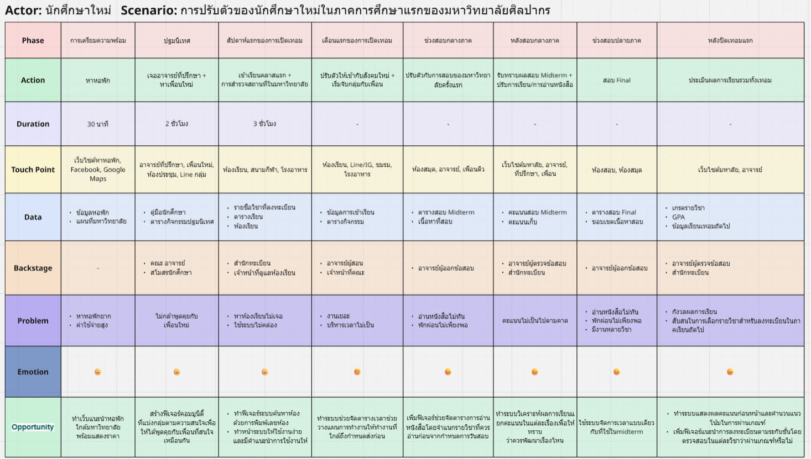

**ผู้รับผิดชอบ** 
660710709 ธนกฤต เวทยนุกูล รับผิดชอบ Phase และ Action 
660710741 ศิริวุฒิ ชัยเกียรติธรรม รับผิดชอบ Emotion 
670710713 ชนัสถ์นันท์ วะรีวะราช รับผิดชอบ Backstage และ Problem 
670710322 ธันยธรณ์ บุญมาก รับผิดชอบ Touch Point 
670710746 ณัฎฐพล ดาเจริญ รับผิดชอบ Data 
670710729 พิทักษ์พล ชยานนท์นุรักษ์ รับผิดชอบ Duration และ Opportunity 

### 2.5 Traceability จากที่มาไปสู่ Requirement (ระบุ requirement แต่ละข้อมาจากไหน)
<!-- TODO: ตาราง Requirement | ที่มา (INT/SRV + timestamp) -->
| Requirement | UC | ปัญหา | ที่มา (หลักฐาน) | Stakeholder |
|---|---|---|---|---|

## 3. ผู้มีส่วนได้ส่วนเสีย (Stakeholder)

### 3.1 Stakeholder Map
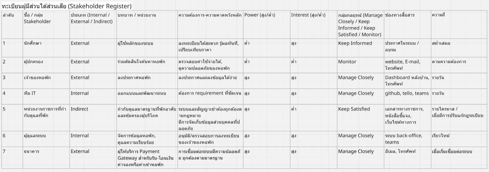

**ผู้รับผิดชอบ** 
660710709 ธนกฤต เวทยนุกูล 
660710741 ศิริวุฒิ ชัยเกียรติธรรม 

### 3.2 Onion Diagram
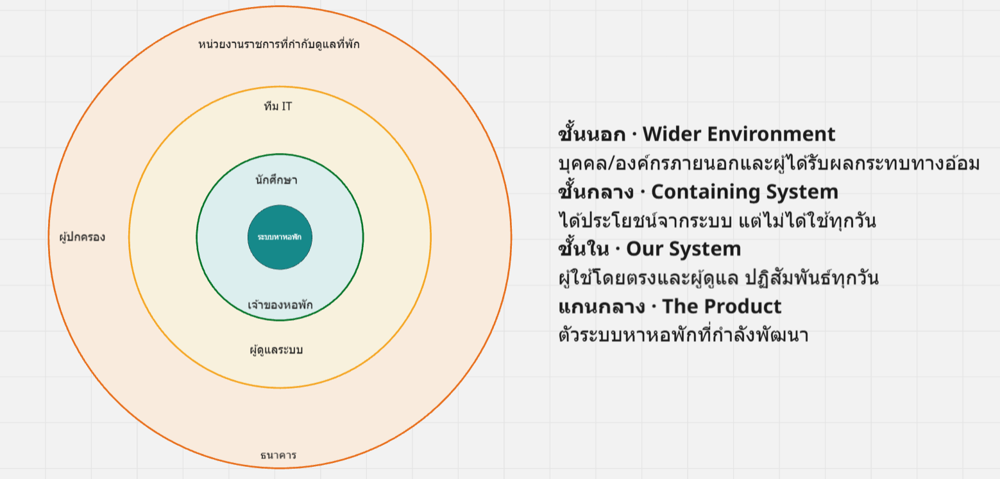

**ผู้รับผิดชอบ** 
670710729 พิทักษ์พล ชยานนท์นุรักษ์ 
670710746 ณัฎฐพล ดาเจริญ 

### 3.3 ตารางสรุป Stakeholder (บทบาท ความสนใจ อิทธิพล)
| Stakeholder | ประเภท (Primary / Secondary) | บทบาทในระบบ | ความสนใจ / สิ่งที่ต้องการ | อิทธิพล (สูง/กลาง/ต่ำ) | ผลกระทบจากระบบ (สูง/กลาง/ต่ำ) | UC ที่เกี่ยวข้อง | แหล่งข้อมูล |
|---|---|---|---|---|---|---|---|
| Guest (ผู้สนใจเช่าห้อง) | Primary | ผู้ใช้หลักที่ค้นหาและเปรียบเทียบหอพัก | ค้นหาหอพักที่ตรงความต้องการ ตรวจสอบรายละเอียดได้ถูกต้องครบถ้วน และสร้างบัญชีเพื่อใช้ฟังก์ชันอื่นของระบบ | ต่ำ | สูง | UC-01, UC-02 | UC-01, UC-02 (Stakeholder & Interest) |
| Resident (ผู้เช่า/นักศึกษา) | Primary | ผู้ใช้บริการหอพักที่พักอยู่ | นัดดูห้อง จอง ดูค่าใช้จ่าย แจ้งซ่อม และรีวิว | ต่ำ | สูง | UC-06, 08, 09, 10, 11, 12, 14 | Use Case Diagram (อนุมานจากชื่อ UC) |
| Dormitory Owner (เจ้าของหอพัก) | Primary | ผู้ให้ข้อมูลหอพักและจัดการห้องในระบบ | ให้ข้อมูลหอพักของตนแสดงต่อผู้สนใจได้อย่างถูกต้อง และจัดการห้อง ราคา สถานะห้องว่าง | สูง | สูง | UC-01, 03, 04, 05 | UC-01 (Stakeholder & Interest), System Context |
| System Admin (ผู้ดูแลระบบ) | Secondary | ดูแลและตรวจสอบข้อมูลในระบบ (ไม่มีใน System Context) | ให้การแสดงผลข้อมูลหอพักเป็นไปตามมาตรฐาน และระบบทำงานได้อย่างราบรื่น | สูง | กลาง | UC-01, UC-13 | UC-01 (Stakeholder & Interest) |

## 4. ภาพรวมของระบบ (Overall Description)

### 4.1 System Context (มุมมองของผลิตภัณฑ์ / Product Perspective)
 

**ผู้รับผิดชอบ** 
670710746 ณัฎฐพล ดาเจริญ 

### 4.2 Architecture Overview
 

**ผู้รับผิดชอบ** 
670710729 พิทักษ์พล ชยานนท์นุรักษ์ 

### 4.3 หน้าที่หลักของระบบ (Product Functions)
ระบบค้นหาและเปรียบเทียบหอพักเป็นเว็บแอปที่ช่วยให้ผู้สนใจเช่าห้องค้นหาและดูข้อมูลหอพัก
และให้เจ้าของหอพักจัดการข้อมูลของตนเอง โดยมีหน้าที่หลักดังนี้
| กลุ่มหน้าที่ | รายละเอียด | UC | ส่วนของระบบ (Architecture) |
|---|---|---|---|
| ค้นหาและดูข้อมูลหอพัก | ค้นหาหอพัก ดูห้องว่าง ราคาค่าเช่าและค่าใช้จ่าย รูปภาพ รายละเอียดห้อง และสิ่งอำนวยความสะดวก | UC-01 | User Frontend, Dormitory/Room/Availability/Price/Image & Detail API |
| ติดต่อและนัดหมาย | ติดต่อเจ้าของหอพักและนัดดูห้อง | UC-06 | Contact API |
| จัดการข้อมูลหอพัก | เพิ่ม/แก้ไขข้อมูลหอพัก ลงราคา ค่ามัดจำ ค่าใช้จ่าย เพิ่มรูปภาพและช่องทางติดต่อ | UC-03 | Admin Frontend, Dormitory/Price/Image & Detail/Contact API |
| อัปเดตสถานะห้อง | เปลี่ยนสถานะห้องว่าง/ห้องเต็ม | UC-04 | Availability API |
| ดูสถิติหอพัก | สรุปข้อมูลการใช้งานหอพักสำหรับเจ้าของ | UC-05 | ยังไม่มีใน Architecture |
| บัญชีและการเข้าสู่ระบบ | สมัครสมาชิก เข้าสู่ระบบ จัดการบัญชี | UC-02, 07, 08 | ยังไม่มีใน Architecture |
| บริการสำหรับผู้อยู่อาศัย | จองห้อง ชำระเงิน ดูค่าใช้จ่าย แจ้งซ่อม เขียนรีวิว | UC-09, 10, 11, 12, 14 | UC-11 ใช้ Price API ได้ ที่เหลือยังไม่มี |
| ควบคุมคุณภาพข้อมูล | ผู้ดูแลระบบตรวจสอบและอนุมัติหอพัก | UC-13 | ยังไม่มีใน Architecture |

### 4.4 ลักษณะของผู้ใช้ (User Characteristics)
| กลุ่มผู้ใช้ | คำอธิบาย | ทักษะด้านเทคโนโลยี |
|---|---|---|
| Guest | คนที่กำลังหาหอพัก ยังไม่ได้เป็นสมาชิก เช่น นักศึกษาใหม่ | พื้นฐาน |
| Resident | ผู้ที่พักอยู่และใช้บริการของหอพัก | พื้นฐาน |
| Dormitory Owner | เจ้าของ/ผู้ดูแลหอพักที่ลงข้อมูลในระบบ | พื้นฐานถึงปานกลาง |
| Admin | ผู้ดูแลระบบที่อนุมัติหอพัก | ปานกลาง |

### 4.5 ข้อจำกัด (Constraints)
| รหัส | ประเภท | ข้อจำกัด |
|---|---|---|
| CON-01 | เวลา / ขอบเขต | เป็นงานในรายวิชา มีเวลาจำกัด จึงพัฒนา Prototype เฉพาะ UC-01, 03, 05, 08, 10, 13 ส่วน UC อื่นทำถึงระดับ spec และ plan |
| CON-02 | เทคโนโลยี | Frontend ใช้ React (JSX), Backend แบบ API Layer (Python), ฐานข้อมูล MySQL |
| CON-03 | ระบบภายนอก | ใช้ Google Maps แสดงตำแหน่งและแผนที่ ต้องมีอินเทอร์เน็ตและเป็นไปตามเงื่อนไขการใช้งานของ Google |
| CON-04 | การพัฒนา | พัฒนาแบบ Spec-Driven Development: เขียน spec ก่อน ให้ AI สร้างทีละ task และตรวจตาม Acceptance Criteria |
| CON-05 | การชำระเงิน | ไม่เชื่อมระบบชำระเงินจริง UC-14 เป็นการจำลอง |
| CON-06 | ข้อมูลส่วนบุคคล | ข้อมูลผู้ใช้ต้องใช้อย่างเหมาะสมตามหลัก PDPA (Prototype ใช้ข้อมูลตัวอย่าง) |
| CON-07 | ทีม | ทีมพัฒนา 6 คน แบ่งความรับผิดชอบตาม UC |

### 4.6 ข้อสมมติและความเกี่ยวเนื่อง (Assumptions and Dependencies)
| รหัส | ข้อสมมติ | ผลกระทบถ้าไม่เป็นจริง |
|---|---|---|
| AS-01 | Prototype ใช้ระบบเข้าสู่ระบบจำลอง (mock login) เพราะ UC-07 ไม่ได้พัฒนาจริง | UC ที่ include UC-07 ต้องปรับการทดสอบ |
| AS-02 | มีข้อมูลผู้ใช้ หอพัก และห้องตัวอย่าง (seed data) ใน MySQL เพราะ UC-02 ไม่ได้พัฒนาจริง | ทดสอบ UC-01, 03, 05 ไม่ได้ถ้าไม่มีข้อมูล |
| AS-03 | เจ้าของหอพักกรอกข้อมูลห้อง ราคา และสถานะห้องว่างตรงตามความจริง | ข้อมูลที่ผู้ใช้เห็นอาจคลาดเคลื่อน |
| AS-04 | ผู้ใช้เข้าถึงระบบผ่านเบราว์เซอร์ที่ต่ออินเทอร์เน็ตได้ | ใช้งานไม่ได้ |
| AS-05 | หอพักแสดงในผลค้นหาหลังได้รับอนุมัติจากผู้ดูแลระบบ | ต้องปรับเงื่อนไขแสดงผล UC-01 |

## 5. Use Cases

### 5.2 Use Case Diagram
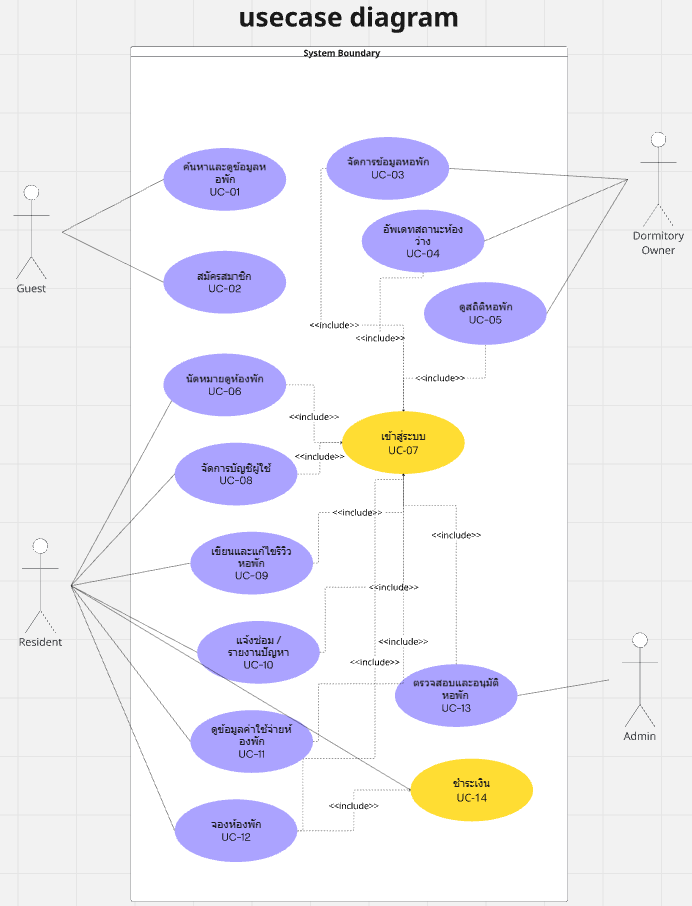 

**ผู้รับผิดชอบ** 
660710741 ศิริวุฒิ ชัยเกียรติธรรม 

### 5.3 Use Case Specification

UC-01 | ค้นหาและดูข้อมูลหอพัก

**ผู้รับผิดชอบ:** 660710709 ธนกฤต เวทยนุกูล

UC-02 | สมัครสมาชิก

**ผู้รับผิดชอบ:** 660710709 ธนกฤต เวทยนุกูล

UC-03 | จัดการข้อมูลหอพัก

**ผู้รับผิดชอบ:** 660710709 ธนกฤต เวทยนุกูล

UC-04 | อัพเดทสถานะห้องว่าง

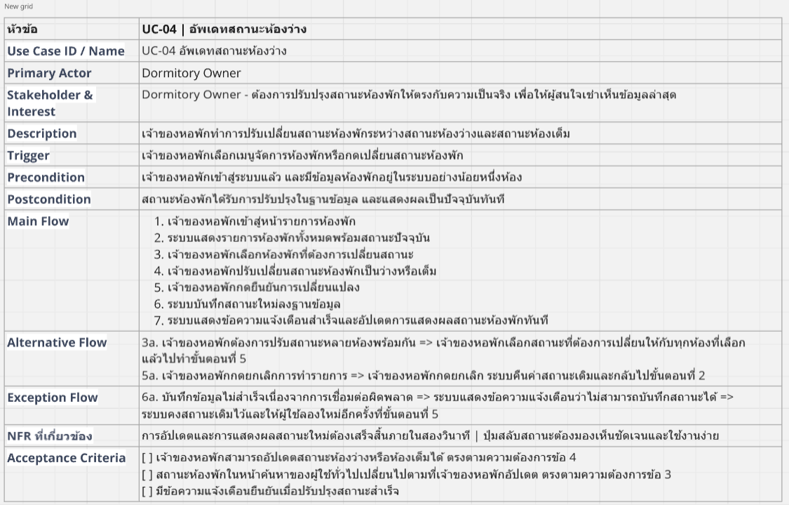

**ผู้รับผิดชอบ:** 660710709 ธนกฤต เวทยนุกูล

UC-05 | ดูสถิติหอพัก

**ผู้รับผิดชอบ:** 660710709 ธนกฤต เวทยนุกูล

UC-06 | นัดหมายดูห้องพัก

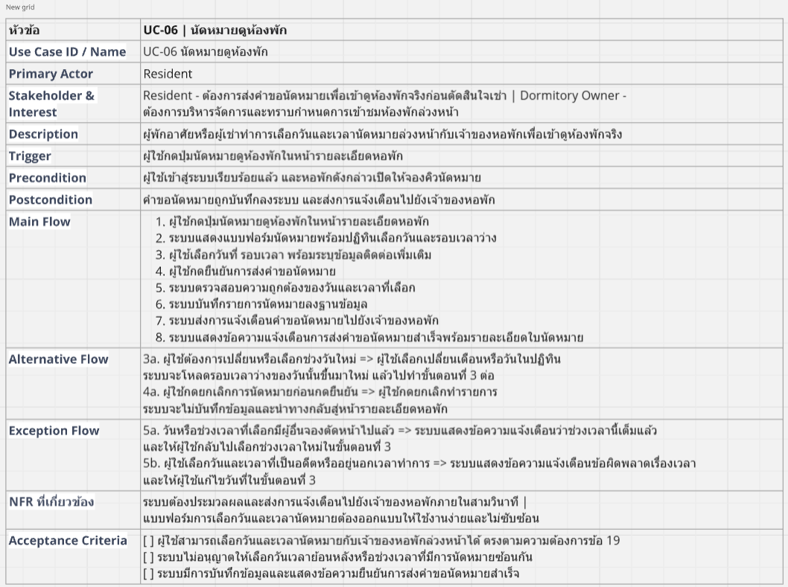

**ผู้รับผิดชอบ:** 660710709 ธนกฤต เวทยนุกูล

UC-07 | เข้าสู่ระบบ

**ผู้รับผิดชอบ:** 660710709 ธนกฤต เวทยนุกูล

UC-08 | จัดการบัญชีผู้ใช้

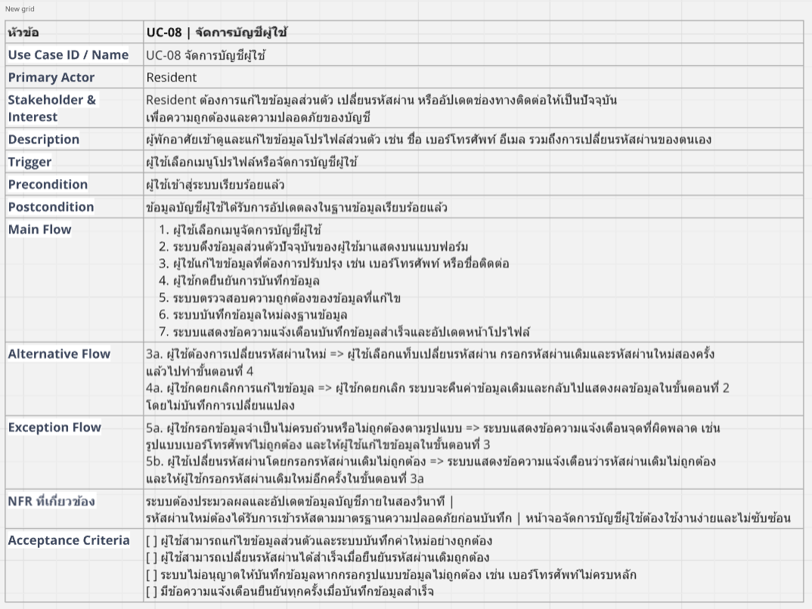

**ผู้รับผิดชอบ:** 660710709 ธนกฤต เวทยนุกูล

UC-09 | เขียนและแก้ไขรีวิวหอพัก

**ผู้รับผิดชอบ:** 660710709 ธนกฤต เวทยนุกูล

UC-10 | แจ้งซ่อม / รายงานปัญหา

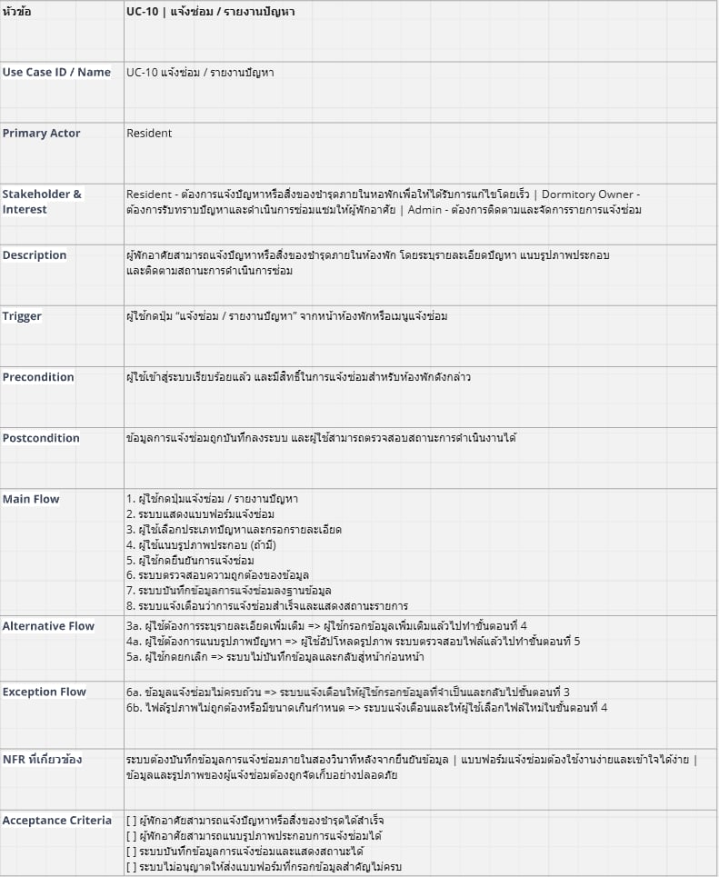

**ผู้รับผิดชอบ:** 670710322 ธันยธรณ์ บุญมาก

UC-11 | ดูข้อมูลค่าใช้จ่ายห้องพัก

**ผู้รับผิดชอบ:** 670710322 ธันยธรณ์ บุญมาก

UC-12 | จองห้องพัก

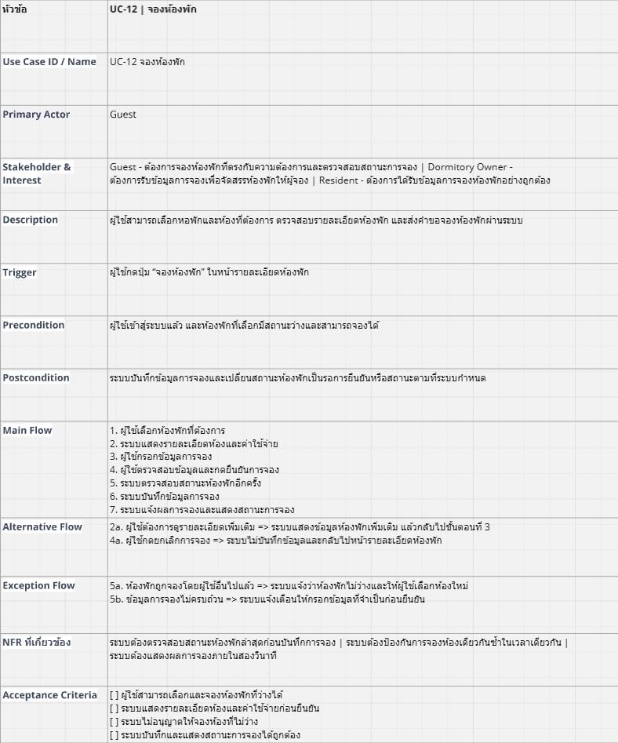

**ผู้รับผิดชอบ:** 670710322 ธันยธรณ์ บุญมาก

UC-13 | ตรวจสอบและอนุมัติหอพัก

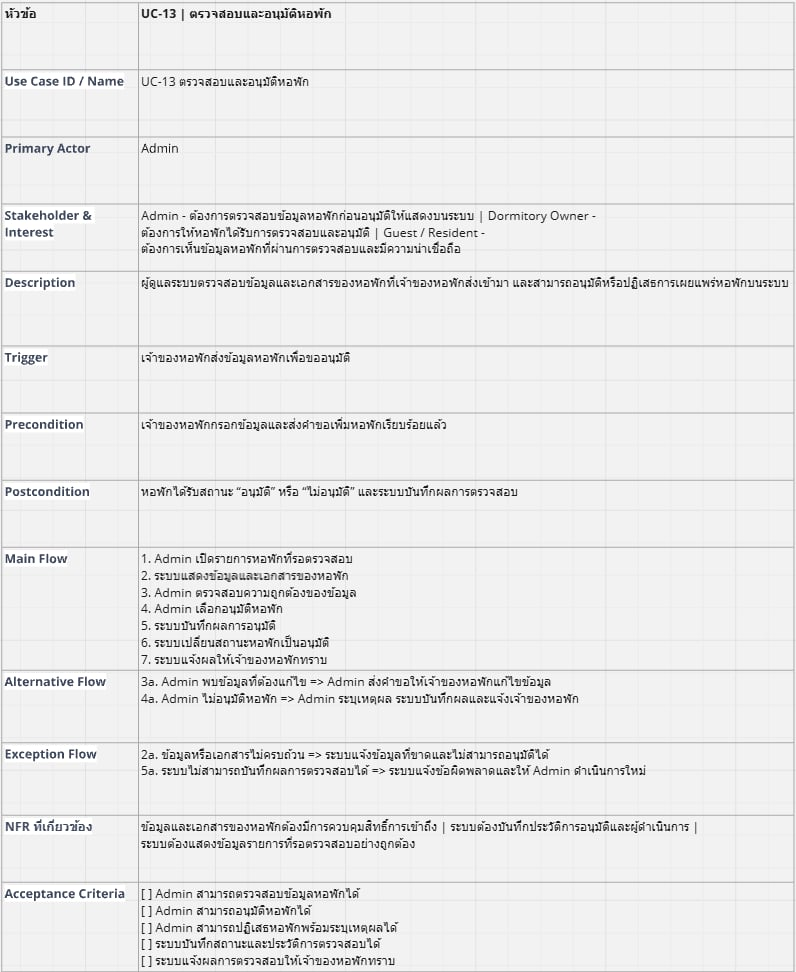

**ผู้รับผิดชอบ:** 670710322 ธันยธรณ์ บุญมาก

UC-14 | ชำระเงิน

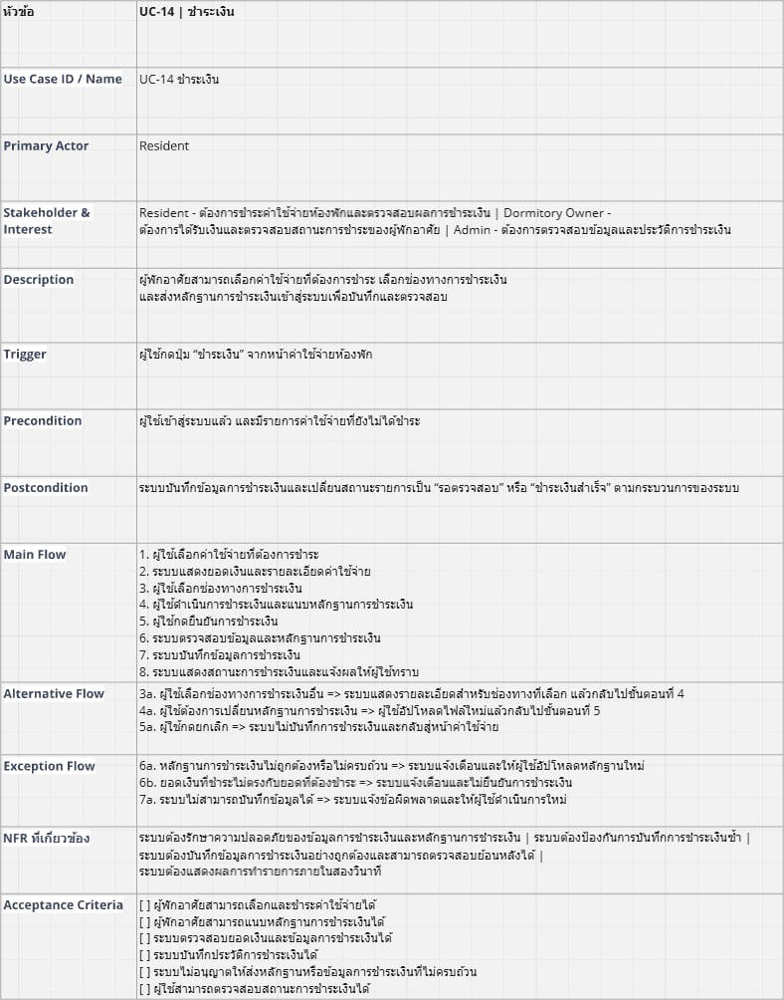

**ผู้รับผิดชอบ:** 670710322 ธันยธรณ์ บุญมาก

---

## 6. ความต้องการเชิงหน้าที่ (Functional Requirements)

### 6.1 Requirement

**ผู้รับผิดชอบ** 
670710713 ชนัสถ์นันท์ วะรีวะราช 

### 6.2 Requirements Prioritization
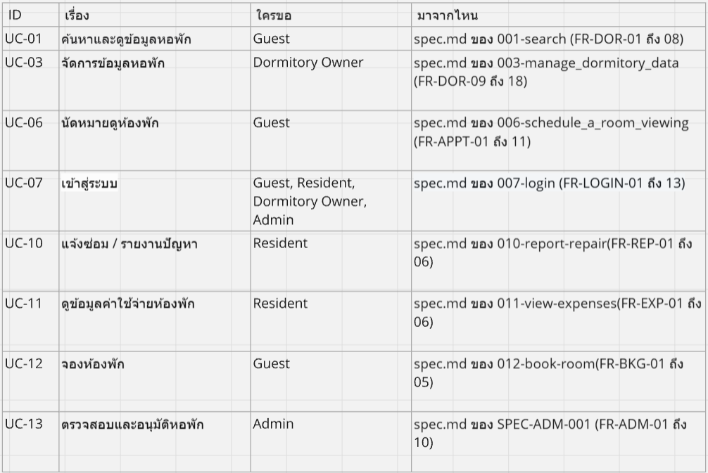

**ผู้รับผิดชอบ** 
660710709 ธนกฤต เวทยนุกูล รับผิดชอบ UC-01 
660710741 ศิริวุฒิ ชัยเกียรติธรรม รับผิดชอบ UC-10, UC-11, UC-12 
670710713 ชนัสถ์นันท์ วะรีวะราช รับผิดชอบ UC-03 
670710322 ธันยธรณ์ บุญมาก รับผิดชอบ UC-13 

### 6.3 รายการ Functional Requirements (FR-001 ...)
<!-- TODO: ใส่ข้อมูล UC ของตัวเองที่ทำทั้งหมดไม่ต้องเพิ่มแถวใหม่ --> 
<!-- ที่มาคือใส่รหัสหลักฐาน และ AC ทำจากหัวข้อที่ 8 ก่อนแล้วค่อยมาใส่ที่เกี่ยวข้อง -->
#### ก. Functional Requirements

| รหัส | # ในรูป | ข้อกำหนด | UC | ลำดับความสำคัญ(Must / Should / Could) | ที่มา | AC | Prototype |
|---|---|---|---|---|---|---|---|
| FR-001 | 1 | ระบบต้องแสดงข้อมูลเกี่ยวกับหอพัก | UC-01 | Must | ... | ... | ✅ |
| FR-002 | 2 | ระบบต้องแสดงราคาค่าเช่าห้อง | UC-01 | Must | ... | ... | ✅ |
| FR-003 | 3 | ระบบต้องแสดงสถานะห้องว่าง/ห้องเต็ม | UC-01 | Must | ... | ... | ✅ |
| FR-004 | 4 | เจ้าของหอพักสามารถอัปเดตสถานะห้องว่างได้ | ... | Must | ... | ... | - |
| FR-005 | 5 | ระบบต้องแสดงรายละเอียดห้องพัก | UC-01 | Must | ... | ... | ✅ |
| FR-006 | 6 | ระบบต้องแสดงรูปภาพห้องพัก | UC-01 | Must | ... | ... | ✅ |
| FR-007 | 7 | ระบบต้องแสดงสิ่งอำนวยความสะดวกภายในหอพัก | UC-01 | Must | ... | ... | ✅ |
| FR-008 | 8 | ระบบต้องแสดงค่าน้ำและค่าไฟ | UC-01 | ... | ... | ... | ✅ |
| FR-009 | 9 | ระบบต้องแสดงค่ามัดจำ | UC-01 | ... | ... | ... | ✅ |
| FR-010 | 10 | ระบบต้องแสดงกฎระเบียบและเงื่อนไขของหอพัก | UC-01 | ... | ... | ... | ✅ |
| FR-011 | 11 | ระบบต้องแสดงสถานที่หรือจุดอำนวยความสะดวกใกล้หอพัก | UC-01 | ... | ... | ... | ✅ |
| FR-012 | 12 | เจ้าของหอพักสามารถแก้ไขข้อมูลหอพักได้ | ... | ... | ... | ... | - |
| FR-013 | 13 | ระบบต้องแสดงสัญลักษณ์ยืนยันว่าหอพักเป็นข้อมูลจริง | UC-01 | ... | ... | ... | ✅ |
| FR-014 | 14 | ระบบต้องแสดงข้อมูลช่องทางการติดต่อของหอพัก | UC-01 | ... | ... | ... | ✅ |
| FR-015 | 15 | ระบบต้องสามารถแยกประเภทหอพักชายและหอพักหญิงได้ | UC-01 | ... | ... | ... | ✅ |
| FR-016 | 16 | ระบบต้องสามารถแสดงข้อมูลความปลอดภัยของหอพักได้ | UC-01 | ... | ... | ... | ✅ |

#### ข. Non-Functional Requirements (รายละเอียดเชิงตัวเลขดูหัวข้อ 7)

| รหัส | # ในรูป | ข้อกำหนด | ลำดับความสำคัญ | ที่มา | AC |
|---|---|---|---|---|---|
| NFR-001 | 17 | ระบบต้องใช้งานง่ายและไม่ซับซ้อน | ... | ... | ... |
| NFR-002 | 18 | ระบบต้องแสดงข้อมูลและรูปภาพของหอพักให้ตรงกับสภาพห้องจริง | ... | ... | ... |

#### ค. Domain Requirements

| รหัส | # ในรูป | ข้อกำหนด | UC | ลำดับความสำคัญ | ที่มา | AC |
|---|---|---|---|---|---|---|
| DR-001 | 19 | การเข้าดูห้องพักสามารถนัดหมายกับเจ้าของหอพักล่วงหน้าได้ | ... | ... | ... | ... |
| DR-002 | 20 | ผู้เช่าต้องได้รับทราบกฎระเบียบและค่าใช้จ่ายก่อนเข้าพัก | UC-01 | ... | ... | ... |

### 6.4 Requirement Smells

UC-01 | ค้นหาและดูข้อมูลหอพัก

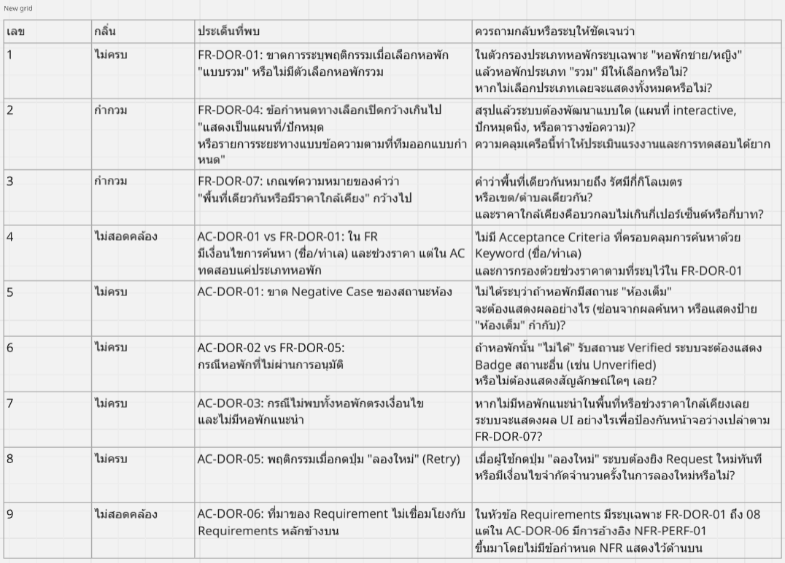

**ผู้รับผิดชอบ:** 660710709 ธนกฤต เวทยนุกูล

UC-02 | สมัครสมาชิก

**ผู้รับผิดชอบ:** 660710709 ธนกฤต เวทยนุกูล

UC-03 | จัดการข้อมูลหอพัก

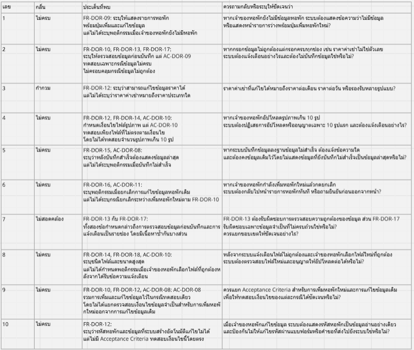

**ผู้รับผิดชอบ:** 670710713 ชนัสถ์นันท์ วะรีวะราช

UC-04 | อัพเดทสถานะห้องว่าง

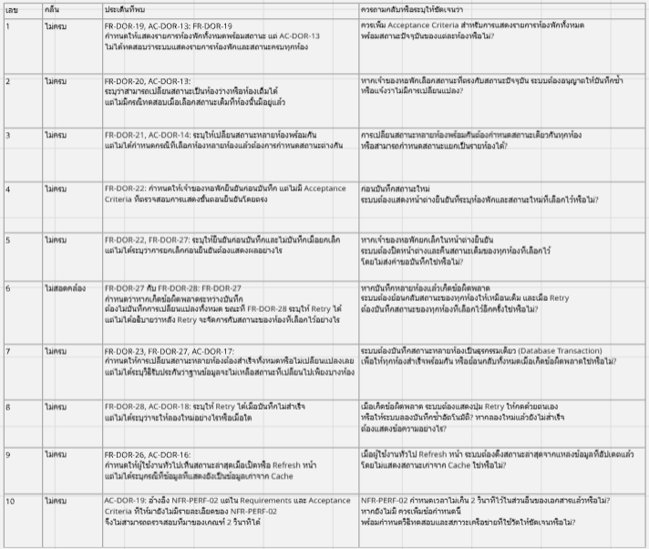

**ผู้รับผิดชอบ:** 670710713 ชนัสถ์นันท์ วะรีวะราช

UC-05 | ดูสถิติหอพัก

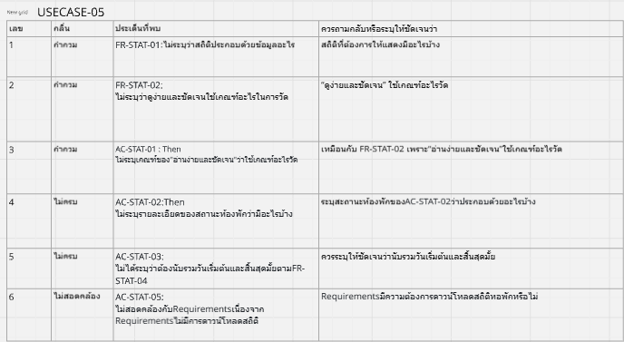

**ผู้รับผิดชอบ:** 670710729 พิทักษ์พล ชยานนท์นุรักษ์ 

UC-06 | นัดหมายดูห้องพัก

**ผู้รับผิดชอบ:** 670710729 พิทักษ์พล ชยานนท์นุรักษ์ 

UC-07 | เข้าสู่ระบบ

**ผู้รับผิดชอบ:** 670710746 ณัฎฐพล ดาเจริญ

UC-08 | จัดการบัญชีผู้ใช้

**ผู้รับผิดชอบ:** 670710746 ณัฎฐพล ดาเจริญ

UC-09 | เขียนและแก้ไขรีวิวหอพัก

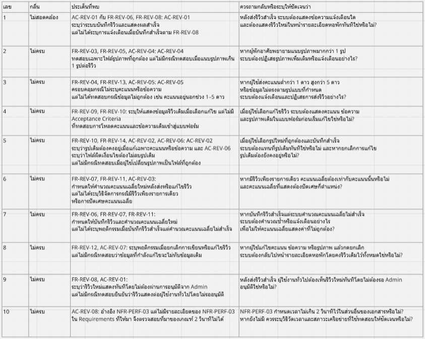

**ผู้รับผิดชอบ:** 670710713 ชนัสถ์นันท์ วะรีวะราช

UC-10 | แจ้งซ่อม / รายงานปัญหา

**ผู้รับผิดชอบ:** 660710741 ศิริวุฒิ ชัยเกียรติธรรม

UC-11 | ดูข้อมูลค่าใช้จ่ายห้องพัก

**ผู้รับผิดชอบ:** 660710741 ศิริวุฒิ ชัยเกียรติธรรม

UC-12 | จองห้องพัก

**ผู้รับผิดชอบ:** 660710741 ศิริวุฒิ ชัยเกียรติธรรม

UC-13 | ตรวจสอบและอนุมัติหอพัก

**ผู้รับผิดชอบ:** 670710322 ธันยธรณ์ บุญมาก

UC-14 | ชำระเงิน

**ผู้รับผิดชอบ:** 670710322 ธันยธรณ์ บุญมาก

## 7. ความต้องการที่ไม่ใช่เชิงหน้าที่ (Non-Functional Requirements)
<!-- TODO: ใส่ข้อมูล Usecase ที่ตัวเองทำทั้งหมด -->
| รหัส | หมวด | ข้อกำหนด | เกณฑ์วัด | วิธีตรวจ | ที่มา |
|---|---|---|---|---|---|
| NFR-001 | ความสามารถในการใช้งาน | ระบบใช้งานง่ายและไม่ซับซ้อน | ... คลิก / ... วินาที | ทดสอบกับผู้ใช้ ... คน | รูป Requirement ข้อ 17 |
| NFR-002 | ความน่าเชื่อถือ | ข้อมูลและรูปภาพตรงกับสภาพห้องจริง | แสดงเฉพาะหอพักที่ Admin อนุมัติ | ตรวจตาม UC-13 | รูป Requirement ข้อ 18 |
| NFR-003 | ประสิทธิภาพ | แสดงผลค้นหาและหน้ารายละเอียดรวดเร็ว | ไม่เกิน ... วินาที | วัดเวลาตอนทดสอบ | UC-01 |
| NFR-004 | ความปลอดภัย | เก็บรหัสผ่านอย่างปลอดภัย | เก็บแบบ hash ไม่เก็บข้อความธรรมดา | ตรวจฐานข้อมูล | UC-02 |
| NFR-005 | ความปลอดภัย | รหัสผ่านมีความยาวขั้นต่ำ | อย่างน้อย 8 ตัวอักษร | ทดสอบกรอกรหัสสั้นกว่า 8 | UC-02 |

## 8. Acceptance Criteria
<!-- TODO: ใส่ข้อมูล Usecase ที่ตัวเองทำทั้งหมด -->

UC-01 | ค้นหาและดูข้อมูลหอพัก

- **AC-01.1** ผู้ใช้พิมพ์ค่าค้นหา และกรองตามประเภทหอพักและช่วงราคาได้ถูกต้อง (FR-015)
- **AC-01.2** ผลการค้นหาแสดงสถานะห้องว่าง/เต็มตรงกับฐานข้อมูลล่าสุด (FR-003)
- **AC-01.3** หน้ารายละเอียดหอพักแสดงข้อมูลครบตาม FR-001, 002, 005-011, 014, 016
- **AC-01.4** หอพักที่ผ่านการตรวจสอบแสดงสัญลักษณ์ยืนยันข้อมูลจริงชัดเจน (FR-013)
- **AC-01.5** เมื่อค้นหาไม่พบ ระบบแสดงข้อความแจ้งที่เข้าใจง่าย แทนหน้าว่างเปล่า
- **AC-01.6** เมื่อโหลดรายละเอียดไม่ได้ ระบบแสดงข้อความแจ้งพร้อมปุ่ม "กลับสู่หน้าค้นหา"

UC-02 | สมัครสมาชิก

- **AC-02.1** ผู้ใช้สมัครบัญชีสำเร็จเมื่อกรอกข้อมูลถูกต้องครบถ้วน
- **AC-02.2** ระบบไม่อนุญาตให้ใช้อีเมลหรือเบอร์โทรศัพท์ที่ซ้ำกับในระบบ
- **AC-02.3** ระบบไม่แสดงรหัสผ่านเป็นตัวอักษรธรรมดา และแจ้งเตือนเมื่อรหัสผ่านไม่ตรงกัน

## 9. ข้อมูลและอินเทอร์เฟซ (Data & Interface Requirements)

### 9.1 ส่วนติดต่อผู้ใช้ (UI)
<!-- TODO: ใส่ข้อมูล Usecase ที่ตัวเองทำเป็น prototype -->
| หน้าจอ | UC | ภาพ |
|---|---|---|
| หน้าแรก / ค้นหา | UC-01 |  |
| รายละเอียดหอพัก | UC-01 |  |

### 9.2 ส่วนติดต่อซอฟต์แวร์ / API
<!-- TODO: ใส่ข้อมูล api ของตัวเองที่ทำเป็น prototype -->
| API | หน้าที่ (ตามรูป Architecture) | Endpoint หลัก | UC |
|---|---|---|---|
| Dormitory API | จัดการข้อมูลหอพัก | ... | UC-01 |
| Room API | จัดการข้อมูลห้อง | ... | UC-01 |
| Availability API | จัดการสถานะห้องว่าง/เต็ม | ... | UC-01 |
| Price API | จัดการค่าเช่า ค่าน้ำ ค่าไฟ ค่ามัดจำ | ... | UC-01 |
| Image & Detail API | จัดการรูปภาพและรายละเอียด | ... | UC-01 |
| Contact API | จัดการช่องทางติดต่อ | ... | UC-01 |

## 10. คำถามที่ยังไม่รู้ (Open Questions)
| รหัส | คำถาม | เกี่ยวกับ | สถานะ | คำตอบ / การตัดสินใจ |
|---|---|---|---|---|
| OQ-01 | UC-05, 08, 10, 13 จะทำ Prototype แต่ไม่มี requirement ในรูป Requirement จะเพิ่มข้อกำหนดหรือไม่ | 6.3 | เปิด | |
| OQ-02 | UC-01 ไม่มี FR สำหรับการค้นหา การกรอง และการแจ้งเมื่อไม่พบข้อมูล (AC-01.1, 01.5 ยังไม่มี FR รองรับ) | 6.3, 8 | เปิด | |
| OQ-03 | UC-02 สมัครสมาชิกไม่มี FR ในรายการ ต้องเพิ่มหรือไม่ | 6.3, 8 | เปิด | |
| OQ-04 | FR-001, 011, 013, 016 ยังคลุมเครือ ("ข้อมูลเกี่ยวกับหอพัก", "ใกล้หอพัก", "ข้อมูลจริง", "ข้อมูลความปลอดภัย") นิยามให้ชัดอย่างไร | 6.3 | เปิด | |
| OQ-05 | เกณฑ์วัดของ NFR-001 "ใช้งานง่าย" และเวลาตอบสนองของ UC-01 (ช่วง 2-3 วินาที) จะใช้ค่าไหน | 7 | เปิด | |
| OQ-06 | Architecture ไม่มี API สำหรับสถิติ บัญชี แจ้งซ่อม และอนุมัติ จะเพิ่มลงรูปหรือไม่ | 4.2, 9.3 | เปิด | |
| OQ-07 | "Admin Frontend" ใน Architecture ใช้โดยเจ้าของหอพัก แต่ Admin ใน Use Case คือผู้อนุมัติ จะเปลี่ยนชื่อหรือแยกหน้าจอหรือไม่ | 4.2, 5.2 | เปิด | |
| OQ-08 | System Context ไม่มี Admin และ Google Maps รวมถึงชื่อ "ค้นหาและเปรียบเทียบ" ไม่มี UC เปรียบเทียบรองรับ จะแก้รูปหรือเพิ่ม UC | 4.1 | เปิด | |
| OQ-09 | เจ้าของหอพักและ Admin สร้างบัญชีอย่างไร (UC-02 เชื่อมกับ Guest เท่านั้น) | 5.2 | เปิด | |
| OQ-10 | UC-14 ชำระเงินเป็นของจริงหรือจำลอง | 4.5, 4.6 | เปิด | |
| OQ-11 | หอพักแสดงในผลค้นหาหลังอนุมัติ (UC-13) เท่านั้นใช่หรือไม่ | 4.6 | เปิด | |
| OQ-12 | รูป Requirements Prioritization (UC-01, 03, 10, 11, 12, 13) ไม่ตรงกับชุดที่ทำ Prototype (01, 03, 05, 08, 10, 13) จะแก้ฝั่งไหน | 6.2, 1.2 | เปิด | |
| OQ-13 | Prototype ใช้ Google Maps จริงหรือจำลอง | 9.4 | เปิด | |

## 11. Traceability Matrix

### 11.1 วิธีอ่านตาราง
เส้นทางตามรอย: FR/NFR → UC → AC → Task → Test → Prototype
- Task: รหัสจาก `specs/00X/tasks.md`
- Test: รหัสจาก `specs/00X/test-cases.md`
- สถานะ: ✅ ผ่านจริง | ❌ ไม่ผ่าน | ⏳ ยังไม่ได้ทดสอบ 

### 11.2 ตารางหลัก
<!-- TODO: ใส่ข้อมูล Usecase ที่ตัวเองทำใน prototype -->

 

UC-01 | ค้นหาและดูข้อมูลหอพัก

| FR / NFR | ใน Requirement | AC | Task | Test case | Prototype | สถานะ |
|---|---|---|---|---|---|---|
| FR-DOR-01 | 15 | AC-DOR-01 | T-03, T-04, T-05 | TC-DOR-01-1, 01-2, 01-3 | [หน้าค้นหา](...) | ✅ |
| FR-DOR-02 | 3 | AC-DOR-01 | T-03, T-04, T-05 | TC-DOR-01-1, 01-2 | [หน้าค้นหา](...) | ⏳ |
| FR-DOR-03 | 1, 2, 5-11, 14, 16 | AC-DOR-02 | T-06, T-07, T-08 | TC-DOR-02-1, 02-2 | [หน้ารายละเอียด](...) | ⏳ |
| FR-DOR-04 | 1, 2, 5-11, 14, 16 | AC-DOR-02 | T-06, T-07, T-08 | TC-DOR-02-1, 02-2 | [หน้ารายละเอียด](...) | ⏳ |
| FR-DOR-05 | 13 | AC-DOR-02 | T-06, T-07, T-08 | TC-DOR-02-1, 02-2 | [Verified Badge](...) | ⏳ |
| FR-DOR-06 | ไม่มีใน req | AC-DOR-04 | T-10 | TC-DOR-04-1, 04-2, 04-3 | [ล้างตัวกรอง](...) | ⏳ |
| FR-DOR-07 | ไม่อยู่ในรูป | AC-DOR-03 | T-11, T-12 | TC-DOR-03-1, 03-2 | [ไม่พบผลค้นหา](...) | ⏳ |
| FR-DOR-08 | ไม่อยู่ในรูป | AC-DOR-05 | T-13, T-14 | TC-DOR-05-1, 05-2 | [หน้า error](...) | ⏳ |
| NFR-PERF-01 | ไม่อยู่ในรูป | AC-DOR-06 | T-15 | TC-DOR-06-1, 06-2, 06-3 | - | ⏳ |
| NFR-ACC-01 | 18 | AC-DOR-02 | T-08 | TC-DOR-02-1 | - | ⏳ |
| NFR-USE-01 | 17 | **ไม่มี AC** | T-09 | **ไม่มี** | - | ⏳ |
| NFR-SEC-01 | ไม่อยู่ในรูป | **ไม่มี AC** | T-16 | **ไม่มี** | - | ⛔ blocked |

### 11.3 สรุปความครอบคลุม
<!-- TODO: ใส่ข้อมูล Usecase ที่ตัวเองทำใน prototype -->

 

UC-01 | ค้นหาและดูข้อมูลหอพัก

| รายการ | จำนวน |
|---|---|
| FR-DOR ทั้งหมด | 8 |
| FR ที่มี AC / Task / Test case | 8 / 8 / 8 |
| NFR ทั้งหมด | 4 |
| NFR ที่มี AC | 2 (PERF-01, ACC-01); ไม่มี: SEC-01, USE-01 |
| ผลรันเทสต์จริง | ผ่านแล้ว |

### 11.4 ลิงก์รายฟีเจอร์
<!-- TODO: ใส่ข้อมูล Usecase ที่ตัวเองทำใน prototype -->
- [001-search](../../specs/001-search/rtm.md)

## 12. ภาคผนวก (Appendices)

### 12.1 ประวัติการแก้ไขเอกสาร (Revision History)
<!-- TODO: ใส่ข้อมูลประวัติการแก้ไขและระบุชื่อ -->
| เวอร์ชัน | วันที่ | ผู้แก้ไข | สิ่งที่แก้ |
|---|---|---|---|
| 0.1 | 20-11-2026 | 660710709 ธนกฤต เวทยนุกูล | ร่างโครงสร้าง SRS |

### 12.2 ตัวอย่างที่ AI สร้างผิดและการแก้ spec
<!-- TODO: ใส่ข้อมูล(ถ้ามี) -->
| รหัส | ฟีเจอร์ / Task | AI สร้างอะไรผิด | สาเหตุที่ spec | แก้ spec อย่างไร | ผลก่อน | ผลหลังแก้ |
|---|---|---|---|---|---|---|
| AI-01 | ... | ... | ... | ... | [ภาพ/ผลเทสต์] | [ภาพ/ผลเทสต์] |